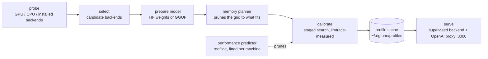

# Using rigtune

The full reference behind the [README](../README.md): how calibration works, every workload, objective and search option, the CLI, and the backend interface. Measured results are in [benchmarks.md](benchmarks.md).

## How it works



1. **Check your hardware.** rigtune detects your GPU, its compute capability and VRAM, CPU cores and AVX2/AVX-512 support, RAM, and which backends can run. Use `rigtune probe` to inspect the resulting `HardwareDescriptor`. Beside each engine's version it lists the torch, transformers, FlashInfer and tokenizers versions in that engine's own environment (SGLang's is asked through `SGLANG_PYTHON`), and every profile records them, since two installs of one engine release can resolve different ones. A cached profile is reused only while they match: a new minor release of torch, transformers or tokenizers, or any new FlashInfer release (it ships the attention kernels), means recalibrating; a patch release of the first three is reused, with a line in the log saying so. Libraries are compared only when both the profile and the probe recorded some. `rigtune probe` also prints the engine releases rigtune was checked with (one record per machine and session in `rigtune/data/conformance/`: vLLM 0.11.0 and 0.29.0, SGLang 0.5.19, each with what was run and whether it passed). Any other vLLM or SGLang release, a patch release included, gets a warning there and in the calibration's log, once, and a note in the profile: its flags, defaults and memory rules may differ from what rigtune plans for. It is never refused. vLLM 0.33.0 and SGLang 0.5.23 are not listed yet: rigtune reads their source for its feature checks and plans SGLang 0.5.23's own prefill chunk, but neither has run with rigtune on a GPU.

2. **Choose candidate backends.** The [supported-hardware table](../README.md#supported-hardware) determines which backends to try. If several are available, calibration decides which one to use.

3. **Prepare the model.** vLLM and SGLang use Hugging Face weights directly, plus any pre-quantized 4-bit AWQ or GPTQ checkpoint of the same model found on the Hub. For llama.cpp, rigtune finds a pre-quantised GGUF on the Hub (Q4_K_M, Q5_K_M, Q6_K or Q8_0), or converts and quantises FP16 weights locally. It only prepares the quantizations that pass memory planning.

4. **Check what fits in memory.** Before launching a backend, the planner estimates its memory needs:

   `estimated = weights + kv_cache(ctx, batch, dtype) + runtime_workspace + safety_margin`

   It keeps a configuration only if `estimated ≤ 0.95 × available`. On a 24 GB card, this reduced 54 vLLM candidates to 48 for a 3B model at 4k context, and to 18 at 32k. None of the admitted configurations ran out of memory in that run. Use `rigtune plan <model>` to see what fits before launching anything.

   Hybrid-attention models (Qwen3.5, Gemma 4, Gemma 3) are planned per layer type, read from the config's `layer_types`, as each engine allocates them. SGLang keeps every Gemma 2 and Gemma 3 layer full, and so does the plan for it. Full-attention layers hold KV for every resident token. Sliding-window layers hold at most the window per sequence. Linear-attention layers hold a fixed recurrent state per running sequence, however short its context: about 49 MiB per sequence for Qwen3.5-9B. So the planner admits longer contexts for these models than before and fewer very large batches. The rules for vLLM and SGLang were read from vLLM 0.29 and SGLang 0.5.19's source and **have not run on hardware**. llama.cpp and vLLM on CPU keep the every-layer-full estimate for these models. `rigtune plan` prints a note when that happens, or when a config's layer layout is not recognised (`"_notes"` in `--json`).

   Where an engine's model registry cannot be imported (SGLang usually runs from `$SGLANG_PYTHON`, another interpreter), rigtune falls back to a fixed list of architectures, which includes Qwen3.5 and Gemma 4. The list knows no engine versions, so an older engine behind `$SGLANG_PYTHON` may be offered these models and fail at launch.

   Each trial records the estimate alongside measured peak memory from NVML and the backend's own weight, KV cache and workspace figures. `rigtune memory-report` shows the errors by backend. Add `--apply` to replace the initial workspace constant and 5% margin with values fitted to your machine.

5. **Benchmark the candidates.** Calibration starts with a short run per quantization and keeps the top two. It then selects the largest safe memory configuration and tries different batch sizes and concurrency levels. Later stages try variations of the leader: speculative decoding first, then the prefill knob, a quantized KV cache and prefix-cache settings (see [Search options](#search-options)). Those three run once for each of the engine's two best speculation settings, on its best configuration with that setting, because they pay differently with speculation on: on an RTX 4090 an int8 cache and a 16k prefill budget did nothing alone and helped a draft model. Every other engine whose best configuration is within 10% of the leader after the batch stage, or that offers a strategy the leader's engine lacks, gets the same stages on that configuration, so a runner-up that gains more from, say, a quantized cache can still overtake; a variation is never carried from one engine to another. Engines offering more strategies go first, and one left more than 10% behind by an engine tuned before it, with nothing that engine lacks, is skipped. A final stage, again per engine, measures its leader with each adopted variation undone, then combinations of the variations that came within 5% of the leader on their own, since some strategies only pay together and some get in each other's way. Last, the leader and up to two other configurations within 10% of it are measured again, one after another, and the pick is made on those runs alone. Choosing the best of many noisy trials flatters the winner (on Dolly-15k prompts the pick measured 603 tok/s in calibration and 547 re-measured), so the profile reports the re-measured number. `--confirm off` skips it.

   A performance predictor helps narrow the search. Its roofline model accounts for weight and KV bandwidth, decode and prefill compute, and queueing beyond the available slots. `rigtune fit` fits three efficiency parameters per backend using your machine's trials. The predictor skips quantizations expected to perform far below the best and tests promising batch settings first. Measurements prune too: once even a backend's best raw throughput is less than half of what a leader reached within the objective's constraints, its remaining quantizations are skipped. Only a configuration that meets the constraints can lead, so under `balanced` a fast configuration that breaks the TTFT ceiling never pushes out a slower backend that meets it. On ShareGPT prompts on an A40, llama.cpp's first reached 470 tok/s against vLLM's 1677, and its other three would have taken 25 minutes to lose. `rigtune predict` shows the predictions without launching a backend; `fit` reports leave-one-out error and rank correlation so you can check their accuracy.

   Each trial replays a fixed workload, synthetic unless you pick a real-text preset. The default uses 16 prompts, a 256-token prefill and a 128-token decode at concurrency 1/4/8, taking roughly 10 seconds. Under `throughput` and `balanced` a trial measures its busiest level first and stops at the first level that meets the objective's limits: it scores at its fastest such level, and throughput rises with load, so a quieter level cannot beat it. Replayed over six recorded calibrations (115 trials) that changed no score and no pick and skipped about a third of calibration time ([details](benchmarks.md#measuring-the-busiest-level-first)). `latency` and `efficiency` can prefer a quieter level, and a power stage compares energy per token over every level, so those measure all of them; `--all-levels` measures every level of every trial anyway, about half as long again, to check the shortcut on your own workload. Before any level, a trial warms up with one short request per slot at the busiest level, so kernels that compile on first use do not land in a measured tail ([why](benchmarks.md#measuring-the-busiest-level-first)). Every request's time to first token is kept, so each p95 has a distribution-free interval computed from the samples alone, at the confidence that sample count can support: 32 requests give about 81% for a p95, not 95%, because the slowest of 32 samples exceeds the true p95 only 80.6% of the time (a one-sided 95% bound needs 59 requests). Under `balanced`, a level whose ceiling falls inside that interval is too close to call from its own requests, so it is measured again with as many requests on fresh prompts and judged on both runs together. On the real-text presets answers end when the model stops, so a level at concurrency c sends a few requests per slot (at least 8) rather than every prompt: sending all 64 ShareGPT prompts one at a time took most of an 8-minute trial. Energy per token is averaged over every level, so on these presets it weighs the busy levels more and reads lower (one A40 configuration: 1.41 J/tok sending every prompt, 0.53 with the cap); compare it only between trials of the same workload. Under `efficiency` each trial also stays measured for 3 s after its last request and records the card's idle power and the energy of its wind-down to idle (`idle_power_w`, `hold_joules`, `hold_s` in the calibration table, both from the energy counter where the driver reports it, else from the sampled power, with the sampled idle figure kept beside); the levels' own numbers come from before that tail, so they are unchanged, and the other objectives measure no tail at all. Where the driver reports NVML's total-energy counter (Volta and newer), each window records its energy beside the sampled integral (`counter_energy_j`), which stays the J/token every objective uses. Neither has run on hardware yet. Each concurrency level gets fresh prompts, so a level never measures a prefix cache the previous level filled; only a workload's deliberately shared prefix repeats. [llmtrace](https://github.com/Aagam-Bothara/llmtrace) measures tokens per second, time to first token (TTFT), time per output token (TPOT), peak memory, GPU utilisation and power.

6. **Save the results.** The chosen configuration, full launch arguments, calibration table and versions are saved in `~/.rigtune/profiles/<hardware_hash>/<model>/<objective>[-<workload>].json`. A hardware or backend version change invalidates the profile, and so does a GPU driver or CUDA version change. Each profile records the constraints it was scored with (TTFT and TPOT ceilings, throughput floor, tie tolerance and the rest) and is served only where the same ones are asked for: non-default constraints add a `limits-<fingerprint>` entry to the file name, and the record itself is checked on reuse. Profiles written before rigtune recorded constraints are recalibrated once, and the log says so. A profile also records the Hub commit of the model it measured, read from the local Hugging Face cache (or asked of the Hub when the model is not cached); when it is reused, the commit of the local snapshot is compared with it, and a different one means recalibrating. When the current commit cannot be read offline the profile is reused and the log says so. A `revision` given to `ModelSpec` in the Python API has a cache file of its own. You can also force a fresh run with `rigtune recalibrate`.

7. **Start serving.** rigtune runs the chosen backend as a supervised process, with health checks and automatic restarts. A proxy on `:8000` exposes `/v1/chat/completions`, `/v1/completions` and `/v1/models`, with streaming passthrough. Visit `/rigtune/profile` to see the active configuration and calibration table.

### Workloads

An interactive chat and a long document query need different settings. Use `--workload` to choose the traffic used during calibration. Each preset has a time-to-first-token (TTFT) limit for the `balanced` objective. rigtune caches profiles separately for each workload, so `serve --workload rag` and `serve --workload chat` each get their own calibration.

| `--workload` | prefill | decode | concurrency | TTFT ceiling | shaped like |
|---|---|---|---|---|---|
| `default` | 256 | 128 | 1 / 4 / 8 | 500 ms | the spec's calibration workload |
| `chat` | 512 | 128 | 1 / 4 / 8 | 500 ms | assistant turns |
| `long-context` | 8192 | 256 | 1 / 2 / 4 | 2000 ms | document Q&A, summarisation |
| `generation` | 128 | 1024 | 1 / 4 / 8 | 500 ms | code / story generation |
| `high-concurrency` | 256 | 64 | 32 / 64 / 128 | 1000 ms | many short requests |
| `rag` | 6144 | 64 | 1 / 4 / 8 | 1500 ms | retrieval-augmented answers |
| `chat-system` | 2048, 1536 of it shared | 128 | 1 / 4 / 8 | 500 ms | a long system prompt on every turn |
| `rag-shared` | 6144, 5632 of it shared | 64 | 1 / 4 / 8 | 1500 ms | many questions about one document |
| `sharegpt` | real, up to 1024 | natural, up to 512 | 1 / 8 / 32 | 1000 ms | first turns of real ChatGPT conversations (ShareGPT) |
| `extract` | real, up to 1536 | natural, up to 384 | 1 / 4 / 8 | 1500 ms | copy the sentences with a number out of a news article (CNN/DailyMail) |
| `code-edit` | real, up to 768 | natural, up to 512 | 1 / 4 / 8 | 500 ms | add type hints to a Python function (HumanEval) |

In the two shared-prefix presets every prompt starts with the same text, which is where prefix caching pays: only the first request should prefill it. The warmup sends that same prefix, so trials measure a warm cache, as production traffic would see.

The last three use real text, downloaded from the Hub on first use, and let the model stop when it is done instead of forcing a fixed answer length. They exist for strategies whose value depends on content: n-gram speculation pays when the answer repeats the prompt, as extraction and code edits do, and random words cannot show that.

#### Your own prompts

The measured results say the best settings depend on what the traffic contains (a draft model added 66% on `extract` and nothing on `sharegpt`), so the most faithful workload is a sample of your own. Pass one with `--workload-file`:

```bash
rigtune serve Qwen/Qwen2.5-3B-Instruct --workload chat --workload-file prompts.jsonl
```

- The file is JSONL, one prompt per line: a JSON string, `{"prompt": "..."}`, `{"text": "..."}` or `{"messages": [{"role": "user", "content": "..."}]}`. A conversation's messages are joined in order; no chat template is applied, as with the built-in real-text presets. A bad line is reported with its line number.
- `--workload` becomes a template: its concurrency levels and latency ceilings apply, and answers stop when the model does, up to 512 tokens.
- The profile's name includes a hash of the file, so editing the file triggers a fresh calibration instead of reusing a profile tuned for the old prompts.
- Every concurrency level gets prompts of its own, so no level measures a prefix cache an earlier level filled. A file with too few prompts for that sends fewer requests per level and says so; a few hundred prompts is plenty for the presets' levels.
- `benchmarks/ablate_strategies.py --workload-file` breaks the resulting pick down by strategy, as for the presets.
- `rigtune compare --workload-file A --eval-workload-file B` calibrates on A and measures every row on B, prompts the search never saw, so the comparison shows whether the pick holds on held-out traffic; the results record both. `benchmarks/make_dolly_prompts.py --offset 300` writes 300 more Dolly prompts that share none with the first 300, and `benchmarks/make_oasst_prompts.py` writes 300 conversation openers from OpenAssistant, a dataset nothing else here uses; with `--sessions` it writes whole conversations instead (the best-ranked reply at each step, at least three user turns, cut to `--turns`), as a session file, and beside it the same conversations flattened (`<out>-flat.jsonl`) with the same `--system` prompt, so the two calibrations differ only in whether history is resent turn by turn.
- `benchmarks/search_baselines.py MODEL --workload-file A --eval-workload-file B` asks whether the search is worth its time. Next to rigtune's pick it measures a rule of thumb (fp8 weights, the engine's 8-bit KV cache, the shortest context the workload allows, batch 256, 90% of memory; one launch, no measuring) and the picks of random search over the same configurations calibration explores, one run per `--seeds` value, each given rigtune's calibration time. Random trials measure levels the way calibration does (busiest first, close calls again) but get no out-of-memory retry. Every pick is then measured `--repeats` times, interleaved with stock vLLM and SGLang.

This is new and so far exercised by tests only; it drives the same real-text harness as `sharegpt`, `extract` and `code-edit`, which has run on GPUs.

#### Conversations: session files

A flat file sends every conversation as one prompt, so calibration never sees the reuse real chat traffic has: each turn resends the conversation so far. A session file keeps conversations whole. Either form below makes one, and the two may be mixed:

```jsonl
{"session": "s1", "system": "You are ...", "messages": [{"role": "user", "content": "Hi"}, {"role": "assistant", "content": "Hello"}, {"role": "user", "content": "Why?"}]}
{"session": "s2", "turn": 1, "role": "user", "content": "..."}
{"session": "s2", "turn": 2, "role": "assistant", "content": "..."}
```

- A file is a session file only when some line has a `session` key together with `messages` (or with `role`, in the one-turn-per-line form), or when `--sessions` is passed. A file of multi-turn `{"messages": [...]}` lines without either is flattened exactly as before (same requests, same name, so its cached profile stays valid), and rigtune logs a notice suggesting `--sessions`. A `session` key beside `prompt` or `text` is ignored, as it always was, with a notice. A byte-order mark at the start of the file is fine.
- In a session file a line without `session` is a session of its own, and a plain prompt is a one-turn session. Turns must alternate user and assistant; a trailing answer is dropped, since nothing follows it. The one-turn-per-line form groups lines by `session` in file order (`turn`, when given, must increase). A system prompt comes from a `system` key or leading system messages. Errors name the line.
- Each session keeps its first 8 turns. A level replays a budget of turns, 6 per concurrency slot (at least 8, and with a session pool 3 per live session, or the pool's sessions would never get a second turn), drawn from twice as many sessions' worth of turns, so it is still starting new sessions when the budget runs out. The file is split so that every level and every re-measure of a close call gets sessions of its own; a small file gets fewer per level and says so, and its busiest levels may then run out of sessions and end below their concurrency.
- `--power` measures every power point on one running engine, so with a session file each point takes sessions after those of the points before it, which would otherwise still be cached. When the file is too small for every point to get as many as a calibration trial, each point draws on fewer (with a warning) rather than replaying any; only a file with fewer sessions than points times levels times two repeats them, and says so.
- Sessions are replayed step by step through `/v1/chat/completions` as `messages`, so the engine applies its own chat template and step n+1 starts with exactly the bytes it rendered for step n; a later step carries the model's own earlier answers. Each level keeps one live session per concurrency slot; a session's finished step goes to the back of the queue, and one session never has two steps in flight. The level keeps its concurrency full until its turn budget is spent, then issues no new step: sessions with steps left are recorded as truncated, not failed.
- The warm-up sends synthetic one-step sessions carrying the system prompt that sessions share, so it is cached as in production, and nothing of any session.
- A session stops before a step whose prompt would pass the longest prompt the planner sized the context for (a generated answer can run longer than the one the file recorded), and that is recorded as a cut, not a failed request. A failed step ends its session, since the next would carry no answer to it.
- Every level records the prefix reuse it achieved: `prefix_reuse`, the share of prompt tokens the engine said it served from its cache, split into `prefix_reuse_first` (first steps, where only a system prompt sessions share can be reused) and `prefix_reuse_later` (later steps, where the history is). Beside it, `reuse_expected` is an estimate of what the conversations made reusable: each step's prompt tokens scaled by how much of its messages, rendered as text, is a prefix of what the engine saw before (the previous step with the answer the engine generated, or for a first step the shared system prompt). It counts characters, not the engine's tokens, and ignores that engines cache whole blocks (vLLM 16 tokens, SGLang's page size), so compare engines on `prefix_reuse_later` rather than on the gap to it. With `--history recorded` a later step carries the file's answer, which the engine never generated, so less is reusable. Achieved far below expected means eviction, or a chat template that does not render an earlier step identically. A level also records `sessions`, `sessions_cut`, `sessions_truncated`, `mean_in_flight` (time-weighted; below the concurrency means a file too small to keep the level full), `effective_pool` (sessions live per dispatch), `reuse_distance` (median requests dispatched between two steps of one session: P - 1 with a pool of P), `idle_gap` (median of those started after its previous step finished: P - c), `working_set_tokens` (the peak of the live sessions' last prompts and answers) and `ttft_by_turn_ms`. A trial with a KV-cache tier also records `cached_by_source` (cached prompt tokens by where they came from: SGLang's own split per reply into `device`, `host` and `storage`, asked for with `return_cached_tokens_details`; vLLM's `vllm:prompt_tokens_by_source` counters into `device` and `tier`, since vLLM does not split host from disk), `ttft_returning_ms` and `ttft_returning_p95_ms` (time to first token from a session's second step on, the steps a tier can speed up), and `ttft_by_hit_ms` (those steps' median by the slowest tier their cache hit came from, or `hit`/`miss` where the engine does not say). Other trials record none of these and send exactly what they did.
- For a session file only, vLLM is launched with `--enable-prompt-tokens-details` and SGLang with `--enable-cache-report`, each when the engine that will run has the flag (read from that engine's own environment), so replies carry `usage.prompt_tokens_details.cached_tokens`; llama.cpp's chat endpoint reports it without a flag. SGLang leaves the field out when nothing was cached, so once a reply in a level carries it a reply without it counts as zero; a level where none does has no count, never a measured zero. rigtune then reads vLLM's `vllm:prefix_cache_queries` and `vllm:prefix_cache_hits` from `/metrics` before and after the level (`reuse_source: metrics`); otherwise the trial is still valid and records `reuse_source: none`. A served session profile launches the engine with the same flag. `--report-reuse` does the same for a flat file or a preset, so a flattened control can be measured the same way: its levels record `prompt_tokens_total`, `cached_tokens_total` and `prefix_reuse`, and the profile is cached under its own name.
- A session resends its history, so calibration runs the prefix-cache stage for it (llama.cpp's `--cache-reuse` and `--kv-unified`) as it does for the shared-prefix presets, and `ablate_strategies.py` measures prefix caching on and off. The performance predictor does not prune a session file's configurations: its longest prompt is mostly history the cache serves, which the predictor would price as fresh prefill.
- The profile records what the winning trial served at the concurrency level the objective scored it at (not its fastest level, which the objective may have rejected): `prompt_tokens_seen` from the engine's own prompt counts (a later step's prompt holds the history, which no count of the file can know), `turns_seen`, `reuse_achieved`, `effective_pool` and `reuse_distance`. They come from that one trial, so a losing configuration or a prefix-cache-off variant cannot colour them. For a session profile, `/rigtune/drift` compares live prompt lengths with those served steps, and reports live prefix reuse next to `reuse_achieved` (a reply without a count is zero, as in calibration) without ever warning on it: reuse also falls with a load spike or a cold cache, which re-tuning would not fix. Other profiles' drift reports are unchanged.
- Four options shape the replay, and are refused without a session file:
  - `--session-pool N` keeps N sessions live per level (at least the concurrency) instead of one per slot. A session's finished step waits behind the others, so its reuse distance is N - 1 requests and its idle gap N minus the concurrency: one per slot keeps its cache entries the most recently used and can never show eviction, and a larger pool tests whether they survive. A level then sends at least 3N turns, from at least 2N sessions, so the pool's sessions get further turns and the pool is refilled; `effective_pool` records what it reached, which a small file can leave below N (calibration warns when a level's sessions cannot fill its budget).
  - `--session-turns N` replays each session's first N turns (default 8).
  - `--history generated|recorded`: a later step carries the model's own answers (default), or the file's, which keeps every configuration's prompts identical, for controlled experiments.
  - `--session-system FILE` makes that file's text every session's system prompt, in place of the file's own.
- `--layout replicas` spreads requests over the replicas by least outstanding requests, with no session affinity, so a session's next step usually lands on an engine that never saw its history; replicas lose most of the reuse a session file measures on one engine.
- The profile's name ends in `-sessions`, then `-t<N>`, `-pool<N>` (the pool asked for) and `-recorded` for the non-default options; `--session-system` changes the hash. The longest prompt a session can reach (system prompt, every user turn, and the answers between them at the length the file recorded, capped at the answer cap) sets the shortest context the planner keeps. An answer the file leaves empty is budgeted at the median of those it records; a file that records none is budgeted at the full cap per answer, which at 8 turns needs contexts above 4096.

Session replay is exercised by tests only; no session file has run on hardware.

#### Agent traces: explicit requests

Session replay assumes each turn appends to the conversation before it. An agent rewrites its prompt instead: it edits its memory in place, summarises and drops old messages, and follows a tool call with a request of its own. A file of explicit requests gives every request's whole message list, and rigtune sends exactly those lists:

```jsonl
{"session": "a1", "requests": [{"messages": [{"role": "system", "content": "..."}, {"role": "user", "content": "hi"}]}, {"messages": [...], "chain": true, "tag": "heartbeat"}]}
{"session": "a2", "request": 1, "messages": [...]}
{"session": "a2", "request": 2, "messages": [...], "max_tokens": 64}
```

- Only a non-empty `requests` list of objects with `messages`, or a whole-number `request` beside `session` and `messages`, makes a file one of explicit requests. Every other file reads as before, with the same requests and the same name: a `requests` or `request` key of any other shape (`"request": "req-7"`, `"requests": []`) is metadata and is ignored, and so is either key beside `prompt` or `text`, as a `session` key there always was. A file of explicit requests is named `...-sessions-explicit`, so it can never take the name of a file read before; in particular a `{"session", "request": 3, "messages"}` line, which used to be a conversation replayed turn by turn, is now one request, under the new name. Every line of an explicit file must take one of the two forms above (errors name the line); the one-request-per-line form groups lines by `session`, and `request` must increase.
- Messages are kept byte for byte, with no stripping. Each needs a `role` of `system`, `user` or `assistant` and a string `content`, and nothing else: write a tool call as assistant text and its result as a user message, since chat templates and tool parsers differ between engines. Keys on a line other than these (a generator's parameters, say) are ignored.
- `chain: true` marks a request sent the moment the one before it finished, as an agent's follow-up to a tool call is. `tag` labels a request in what is recorded; `max_tokens` caps its answer in place of the workload's.
- Each request is sent as written: the engine's answer is not carried into the next request, since the file already says what came next. A chained request goes out as soon as the one before it finishes, ahead of every session waiting in the queue, and the level's turn budget lets an open chain finish (a request sent past the budget always finishes a chain whose first request was sent inside it); every other request waits its turn behind the rest of the pool, as in any session file. Each request records `chained`.
- Each request already holds everything before it, so a level does not replay sessions from their start: it replays a window of each, `--session-turns` measured requests (default 6) from an offset spread over the session's length, after one primer, the request just before them, which puts the session's prefix in the engine's cache as an agent that had been running would have it and is not measured (it still loads the engine, and its output counts toward throughput). The offsets of a level's sessions are stratified, one per equal band of session length in a seeded order, so a level holds early and late requests (late ones are where an agent's context has filled and it starts evicting) in about the proportions the file does. A window never starts or ends inside a chain: the primer neither follows the request before it nor chains to the next, and a window that would end inside a chain runs to its end. A window at a session's start has no primer.
- A level's budget is a window per concurrency slot, 7 requests (8 at the least), and with `--session-pool N` a window per live session; for a file of explicit requests the pool is capped at 8 per slot, so `--session-pool 64` keeps 64 sessions live at 8 users but 8 at one user, whose level would otherwise send 448 requests one at a time. The profile name gets `-t<N>` whenever `--session-turns` is given.
- When the file is read, each request is compared with the one before it in its session, as text (role and content, the way `reuse_expected` renders them), so the result is the same for every configuration and needs no tokenizer. Its kind says how it changed the prompt: `first`, `append` (the previous messages are a prefix of these), `truncate` (these are a prefix of the previous ones: only the end was dropped), `rewrite_head` (the first message differs, as when an agent keeps its memory in the system prompt and edits it) or `rewrite_mid` (a later message differs: memory edited in place, or old messages replaced by a summary). A request without a `tag` is tagged with its kind. Its characters split three ways: `lcp`, before the first character that differs, which is all a prefix cache can serve; behind the edit, what was sent before but now sits after the change, which the engine prefills again although it already had it: the previous request's messages that this one keeps, in their order (a dropped message that later reappears is counted new), and, in the message the change falls in, what follows the edit unchanged; and `new`, the rest. Each request records `lcp` and `new`, and each level `refill_behind_edit`: the share behind the edit, over the level's prompt tokens (each request's share weighted by the engine's prompt count). It is zero on a file that only appends. Not all of it is avoidable: an eviction refills the messages it keeps under any layout, so only the difference between a rewriting file and an appending one of the same events (memgpt minus append, from `make_agent_trace.py`) is prefill a different layout would save.
- Each level also records `reuse_by_kind`, keyed by tag: for each, the `requests` sent, their `prompt_tokens`, `reuse_expected` and `prefix_reuse` (the engine's count, when the level has one) as for the whole level, `refill_behind_edit`, and the median `ttft_ms`, so rewritten requests can be set beside appended ones; and `chain_latency_ms`, the median time from a chain's first request being sent to its last request's first token, which an agent waits through and no single request's time to first token shows. Neither is a constraint: the objective still judges each request's time to first token. The profile records the winning trial's `refill_behind_edit` and `chain_latency_ms` beside `reuse_achieved`. Read them against an appending file of the same events: a `refill_behind_edit` well above the appending file's, with rewritten kinds far slower than `append`, says the agent's prompt layout, not the serving configuration, is costing prefill.
- `--history` and `--session-system` are refused for such a file, since it says what every request sends; the profile records its history as `explicit`. Files are read as UTF-8 text; a gzip-compressed file is not accepted. The shortest context the planner keeps is set by the largest request.
- The warm-up sends the system prompt sessions share, as for any session file: here, the common start of every session's first message, when each is a system message. An agent's first message holds instructions every session shares and then its own memory, so whole first messages are rarely equal; the shared start is what one session can reuse from another, and what a first request's `reuse_expected` counts.

`benchmarks/make_agent_trace.py` writes such a file from a model of MemGPT's published design (Packer et al. 2023); it is not a recording of any agent framework. Each session's prompt is fixed instructions, then the agent's core memory, both in the first (system) message, then a queue of messages headed by a recursive summary of what was evicted. Per user message the agent takes one step or more: each may replace a line of its core memory (`--core-edit-p`), search an archive whose result comes back as a function result (`--retrieval-p`, `--retrieval-tokens`), and chain a further step at once (`--heartbeat-p`, up to 4 per user message). A request that would pass `--window-tokens` first has the oldest `--evict-frac` of the queue replaced by a summary; the default 0.3 is Letta's documented default (`sliding_window_percentage`), not a figure from the MemGPT paper, and each line's `gen` key says so. An edit and an eviction rewrite the prompt; a search result and a heartbeat append to it. Requests are tagged `first`, `user`, `heartbeat`, `core_edit`, `retrieval` or `evict` by what changed them, and their answers capped at `--max-tokens`.

```bash
python benchmarks/make_agent_trace.py -n 200                    # agent-memgpt-n200-s0.jsonl
python benchmarks/make_agent_trace.py -n 200 --layout append    # agent-append-n200-s0.jsonl: the same events
```

- `--layout append` renders the same seeded events with every edit appended to the queue as a function result and the first message never changed, so the two files differ only in where edits land; both evict at the same limit. By the generator's token estimate, 11.7–12.3% of the prompt tokens of the default file (200 sessions, seeds 0, 1 and 2) sit behind an edit, and 3.2–3.6% of the appending one's, all of it from evictions, which refill under any layout: the difference, about 8.5 points, is what the layout costs. Calibrating on each, `refill_behind_edit` and `reuse_by_kind` show what rewriting the prompt costs at the engine, and whether it changes the pick.
- `--retrieval-at head` puts the latest search result in the first message instead, as frameworks that retrieve into the system prompt do; `--meta-refresh` adds a status line to the first message that changes on every request. Both apply to the memgpt layout only.
- Token counts are the generator's estimate (1.25 per word, 4 per message); on a sample of requests counted with GPT-2's tokenizer (the only one at hand; the models rigtune serves were not checked), real counts came to 1.01 times the estimate. The generator's words run about 6 characters per token, not the 4 rigtune assumes for a file, so each line's `gen` key carries `chars_per_token`, and the planner sizes a generated file's prompts with the smallest one (a 6000-token window is then planned as 6912 tokens, where 4 characters per token made it 9472 and dropped every 8k context). Where no tokenizer is available, replay estimates prompts at the same ratio.
- With the defaults a session has about 23 requests of about 4000 tokens, and 200 sessions make a file of about 110 MB. The same parameters and `--seed` give the same bytes on every platform; the parameters are in each line's `gen` key, which replay ignores but for `chars_per_token`, and the non-default ones in the file name. Nothing is downloaded.
- About half of a generated level's requests are chained, and a chained request goes ahead of the queue, so with `--session-pool 64` at 8 users an unchained request waits behind about 103–117 others (the middle half, in a simulation of the scheduler with each request taking 4.5 s, give or take 15%), not the pool's 56.

Explicit requests and the generator are exercised by tests only; no such file has run on hardware.

Prompt lengths are exact when the model's tokenizer is available (prompts are fitted to the target token count), and output tokens are counted from the server's `usage` or the tokenizer, never from stream chunks. The planner drops any config whose context cannot hold prefill + decode.

```bash
rigtune serve meta-llama/Llama-3.2-3B-Instruct --workload chat
rigtune serve meta-llama/Llama-3.2-3B-Instruct --workload rag
rigtune serve meta-llama/Llama-3.2-3B-Instruct --workload long-context
```

### Objectives

Choose what you want to optimise. rigtune ranks configurations using the rules below, rather than combining the measurements into a weighted score.

| `--objective` | Rule |
|---|---|
| `throughput` | Highest tokens per second |
| `latency` | Lowest request latency (TTFT + TPOT × output tokens) while meeting the minimum tokens per second |
| `balanced` (default) | Highest tokens per second while the 95th-percentile TTFT stays within the workload's limit; override the limit with `--ttft-ceiling`, or judge it on the median with `--ttft-percentile 50` |
| `efficiency` | Lowest joules per token while meeting the minimum tokens per second; with `--arrival-rate`, lowest joules per request at that rate, the card's idle draw and wind-down included ([below](#energy-at-your-arrival-rate)) |

Every objective also respects a per-token latency (TPOT) ceiling, the decode-phase counterpart of the TTFT limit. Each workload carries one (50 ms for `chat`, `chat-system`, `generation`, `extract` and `code-edit`, 150 ms for `high-concurrency`, 100 ms otherwise) and `--tpot-ceiling` overrides it, so no configuration can win by starving either phase.

`latency` used to rank by TTFT alone. It now counts the whole answer, because speculative decoding leaves TTFT unchanged and cuts time per token, and a TTFT-only rule could never pick it. Profiles cached under the old rule should be recalibrated.

`balanced` used to judge its ceiling on the median TTFT, which lets half the requests run past it. In 8 of 20 recorded comparisons the load chosen that way sent more than 1 request in 20 over the ceiling, so the 95th percentile is now the default ([re-scored results](benchmarks.md#judged-at-the-95th-percentile)). Calibrated that way on Dolly-15k prompts on an A40, rigtune measured 22.8% more than stock vLLM ([details](benchmarks.md#the-p95-search-on-hardware-and-the-new-options)). A `balanced` profile picked by the median is not served under the new rule, so each recalibrates once; `--ttft-percentile 50` still serves it.

Scores within 2% of each other count as a tie. A tie goes to the configuration that switches on fewer optional strategies (a quantized KV cache, speculative decoding, a non-default prefill budget, llama.cpp's prefix flags), so a strategy is adopted only when it measurably wins. After that, the larger context and batch win, then the lower energy per token.

The minimum throughput defaults to 50% of the best observed tokens per second. Set `--tok-s-floor` to use an absolute value instead. If no configuration meets the constraint, rigtune chooses the one that comes closest and records that in the profile.

#### Stating your own goal

The four objectives are goals: one metric to optimise within limits. `--optimise` names the metric and each `--limit` adds a limit, so you can ask for what no preset says:

```
rigtune bench <model> --optimise joules_per_token --limit "tok_s>=200" --limit "ttft_p95_ms<=800"
rigtune serve <model> --optimise tok_s --limit "power_w<=250"
rigtune bench <model> --objective balanced --limit "mem_mb<=20GiB"     # balanced's own goal, plus a limit
```

| metric | is | `--optimise` | units in `--limit` |
|---|---|---|---|
| `tok_s` | tokens per second (more is better) | yes | none, or `%best`: a share of the best trial's tok/s |
| `ttft_p95_ms`, `ttft_p50_ms` | 95th-percentile and median time to first token | yes | `ms` (default), `s` |
| `tpot_ms` | time per output token | yes | `ms`, `s` |
| `request_latency_ms` | median request latency, TTFT + TPOT × output tokens (the `latency` objective's) | yes | `ms`, `s` |
| `joules_per_token` | energy per output token | yes | none |
| `cost_per_mtok` | US dollars per million output tokens, at `--gpu-hourly-usd` (and `--kwh-usd`) | yes | none |
| `power_w` | mean board power | limit only | `W` |
| `mem_mb` | peak GPU memory | limit only | `MiB` (default), `GiB` |
| `accuracy_loss` | accuracy points lost against the most precise format, certified on `--eval-set` ([below](#labelled-eval-sets)) | limit only | points (`1%` is one point) |

A limit is `<=` for a metric that is better lower and `>=` for one better higher, and includes its bound. Quote each limit: unquoted, the shell takes `>` and `<` as redirects (PowerShell and bash alike), and rigtune then sees `tok_s` with no bound and says so. Every refusal (an unknown metric, a limit-only metric to `--optimise`, a limit the wrong way round, `<` or `>`, `%best` on anything but `tok_s`, one metric limited twice differently) comes before anything is probed or downloaded. With `--optimise`, `--ttft-ceiling` (with `--ttft-percentile`), `--tok-s-floor` and `--tpot-ceiling` state limits of that goal; the workload's TPOT ceiling applies to every goal unless a limit or `--tpot-ceiling` replaces it, and `--optimise` with `--objective` is refused. `--limit` with `--objective` (or with neither, which is `balanced`) leaves the older flags meaning what they always meant for that preset, and a limit the preset has a setting for becomes that setting: a TTFT ceiling under `balanced`, and under `efficiency` at an `--arrival-rate`, which judges latency against it; a throughput floor under `latency` and `efficiency`; the TPOT ceiling under all four. So `--objective balanced --limit "ttft_p95_ms<=300"` is `--objective balanced --ttft-ceiling 300`. A named preset never turns into another: a limit it has no setting for makes the goal custom (the preset's own goal plus that limit, with a line saying so), unless that goal is another preset's, which is refused (`--objective throughput --limit "ttft_p95_ms<=300"`: ask for `--objective balanced`), or an arrival rate is given, which is refused too, since at a rate `efficiency` scores joules per request. `--ttft-percentile 50` with a `ttft_p95_ms` limit is refused rather than one of them dropped.

A goal a preset says is that preset: `--optimise tok_s --limit "ttft_p95_ms<=300"` is `--objective balanced --ttft-ceiling 300`, and `--optimise joules_per_token --limit "tok_s>=50%best"` is `--objective efficiency`, with the same cached profile. Before calibrating, one line says the goal and whether it is a preset. Any other goal is the `custom` objective: its text is recorded in the profile (and shown as `goal:`), and its profile is cached as `custom-limits-<fingerprint>-optimise-<metric>.json`, so two goals never share one. A custom goal scores a level that did not measure a metric as missing that limit (and as worst when it is the optimised one); it never falls back to tok/s as `efficiency` does. When nothing meets every limit it picks the configuration that missed the fewest, then the one least far past them relative to each bound. Only a goal optimising `tok_s`, or `cost_per_mtok` at an hourly price alone (below), stops a trial at its busiest level that meets the limits; any other custom goal measures every level, which never misses the winner and takes about half as long again. A custom goal has no idle tail. `cost_per_mtok` is (`--gpu-hourly-usd` + `--kwh-usd` × measured W / 1000) / (tok/s × 3600) × 10⁶: output tokens only, a prompt's tokens cost nothing in it. Without `--kwh-usd` it is the hourly price over tok/s, so it orders levels and configurations exactly as tok/s does and stops early as a `tok_s` goal does; its pick can still differ from `tok_s`'s where two configurations sit at the edge of the 2% tie band, which is measured on the score (cost rather than tok/s), so the tie-breaks group them slightly differently (on every recorded calibration table it picked the same). It is worth having as a limit (`--optimise ttft_p95_ms --limit "cost_per_mtok<=0.4" --gpu-hourly-usd 2.5`). With `--kwh-usd` power counts, a quieter level can win, every level is measured, and the goal needs NVML's power readings. The prices are part of the goal, so they are part of its profile's fingerprint; given without a goal that names `cost_per_mtok` they are refused. `--limit "accuracy_loss<=1"` is `--max-accuracy-loss 1`: it needs `--eval-set`, is refused without one, and is no part of the goal, so a `--limit` that holds only it leaves the preset and the older flags exactly as `--max-accuracy-loss` would (same profile). Once the hardware is probed, and before any weights download, a custom goal that reads power (`joules_per_token`, `power_w`) and is about to be calibrated (a cached profile is served without measuring anything) takes one NVML power reading on the GPU it would use and is refused, with the reason, when there is no NVIDIA GPU, no pynvml, or no power reading; `efficiency` is never refused, and still orders by tok/s without one. A custom goal is calibrated for one engine on one GPU in this version: `--layout` other than `single`, `--phases` other than `unified` (unless `auto` finds fewer than two GPUs) and `--arrival-rate` are refused with it. Under `rigtune compare` a custom goal scores every row by its own limits, writes `<hardware>__<model>__<workload>__custom-<metric>-<hash>.json`, and records the goal and each row's value of its metric (`goal`, `scored_objective`; a preset comparison's file has neither); `--repeats` still keeps each row's median-tok/s run, and `--verdict`, which weighs tok/s, is refused unless the goal optimises `tok_s`. **Custom goals are exercised by tests on simulated trials and recorded calibration tables only; none has run on hardware.**

#### Energy at your arrival rate

Calibration measures every level closed-loop: the load generator keeps c requests in flight, so the GPU never idles, and joules per token contains neither the card's idle draw between requests nor its wind-down after a burst. A server that receives a request every few seconds pays both, and at a low rate the idle draw can be most of each request's energy. `--arrival-rate 0.5` (or `12/min`, `720/h`) tells `efficiency` the rate you expect, and every configuration is then scored by joules per request at that rate:

    J/request(λ) = P̄(n) / λ  +  E_hold × e^(−n) × (1 − e^(−λτ)) / (λτ),   P̄(n) = Σ_k Pois(k; n) × P(k)

- **Measured per trial:** each level's tokens per second and mean power; after the last level, the card's idle power P_idle and the energy E_hold and duration τ of its wind-down, over a 6 s tail (both from the NVML energy counter where the driver reports it, else from the sampled power).
- **One request size for every configuration:** answers stop when the model does on real text, and their length differs between configurations, so every trial is counted in requests of L tokens, the median answer length at the workload's lowest level across the calibration's trials (the profile says which). R_c is then the level's tokens per second ÷ L and W_c = c / R_c (Little's law), so a configuration cannot win by answering shorter. The note still gives the winner's J/request at its own answers' length, and names every configuration whose answers are more than 25% longer or shorter than the median as output-changing (on the A40's Dolly calibration, greedy decoding with an fp8 KV cache answered the same prompts in 393 tokens at 1 user, where the same configuration without it answered in 173 and the median was 194): it changes what is generated, so its energy compares different work.
- **Composed:** the mean number in flight n solves n = λ × W(n) between the measured levels. The number actually in flight is a Poisson count k with mean n, so the card's mean power is P̄ = Σ Pois(k; n) × P(k), with P(0) the idle power and P(k) the closed-loop power at concurrency k, linear between measured levels, and J/request is P̄ / λ plus the wind-down ([derivation](writeup.md#4-measurement-and-the-energy-objective)). At 1.7 in flight on average the server is empty 18% of the time, and that time is charged at idle power. Power is interpolated rather than energy per request because it predicts a left-out level: from the 1- and 8-user levels of the recorded A40 and RTX 4090 calibrations, power and W predicted the 4-user level within a median of 6%, energy per request straight across overshot it 2.2–2.5×. Idle power is pooled per engine and power setting, as the median of every trial's reading, and a configuration is scored at its own reading only when that is outside three robust standard deviations of the median (at least 2 W); the note gives each pool's median and range. A wind-down is paid at the end of each busy period, when the server empties, which with n in flight on average happens for a share e^(−n) of arrivals; the next arrival cuts it short. The wind-down is measured once, after a burst at the trial's busiest level, and charged per busy period, which at a low rate is mostly a single request: that assumes the two wind down alike, which the rate check below tests.
- **Constraints:** nothing is extrapolated. A rate above 80% of the lowest rate served by the level covering the 95th percentile of requests in flight and every level above it is infeasible, so throughput that falls under load caps it, while single-request throughput does not: arrivals that overlap are batched. An arrival that finds k others in flight is served with k + 1, and k is a Poisson count with mean n, so the latency ceilings are judged on every measured level from the one covering n to the one covering the 95th percentile of k + 1, and the worst of them decides: at 0.6 in flight on average, an arrival shares the server with two or more others about 1 time in 8. When that percentile is past the busiest level measured, the latency there is unknown and the rate is not eligible. The throughput floor does not apply. A trial whose lowest measured level is above the workload's lowest cannot be judged at a rate that needs fewer in flight, and is infeasible there. When no trial has idle data, all fall back to J/token × L and say so; when some do, those without it are not eligible, because the fallback leaves the idle draw out and would win on that alone. When nothing is feasible, the least-violating trial is chosen in that order: idle data first, then sustainability, then latency, never a sum of requests per second and milliseconds.
- **What the profile says:** the winner's J/request split into idle, serving and wind-down, how many requests are in flight on average, the spread of idle and serving energy across the configurations measured, and, when idle is more than half of each request, that no configuration can move it. A power cap cannot lower idle draw either; it only shortens a wind-down that draws more than the cap, so with `--power` at a low rate the power stage will find little.

The composed figure is a model, so after the pick the winner is launched once more and sent requests at Poisson arrival times at the rate: at least 24 and at least 20 s of them (more at a high rate), never a window past 5 minutes (fewer at a low rate; below 1/300 req/s the check is skipped and says so). The schedule is seeded, so it repeats, and its gaps are scaled so the window lasts exactly requests ÷ rate. Its energy over the whole window, gaps included, over its requests is the measured J/request, and the profile's notes put it beside the model's prediction recomputed for requests as long as the check's own answers, since the idle term P_idle / λ is paid per request whatever its length ("rate check at 0.5 req/s over 24 Poisson arrivals (48 s): predicted P J/request at those L tokens/request, measured M J/request at L tokens/request (±x%)"). Its p95 time to first token is reported too, and from 24 requests it is close to their slowest rather than a true 95th percentile. The check is recorded in the calibration table as a `rate-check` row, is not counted as a calibration trial, and never takes part in the choice; a replica or disaggregated layout chosen afterwards is not re-measured, and the profile says so. On a session file it sends each session's first turn as one request, so it does not replay the conversations. `--rate-check off` skips it.

The rate is part of the profile's cache name (`-rate-0.5rps`), so a profile picked by J/token is never served where a rate was asked for, and the other way round; `/rigtune/profile` shows it under the workload. It applies to `--objective efficiency` only and is refused with any other. Only single-engine trials carry idle data, so at a rate a replica or disaggregated layout is not eligible beside the single-engine pick (the note counts them), and CPU-side power (SGLang's scheduler spins a core while idle) is invisible to NVML. **This is implemented and tested against simulated telemetry, and re-scored on recorded calibrations under assumed idle and wind-down figures, where it moved one pick by 2.5%, inside run-to-run noise ([table](benchmarks.md#energy-at-an-arrival-rate-re-scored-under-assumptions)); it has not run on hardware, and nothing yet shows that it saves energy.** On the recorded presets, whose busiest level is 8 users, latency can be judged up to about 0.8 req/s on the RTX 4090 and 1.5 req/s on the A40; a busier rate is reported as not eligible.

### Energy tuning: power cap and clock lock

LLM decode is memory-bandwidth bound. Past a certain core clock the SMs wait on memory, so extra frequency buys almost no throughput while power keeps rising. `--power` adds a fourth calibration stage that looks for that point on the winning configuration:

| `--power` | What it sweeps |
|---|---|
| `off` (default) | nothing |
| `cap` | board power limit at 85%, 70% and 55% of the default |
| `clock` | locked SM clock at 85%, 70% and 55% of the maximum, snapped to supported steps |
| `both` | both sets: six points, not the cross product |

Both knobs are applied through NVML to the already-running server, so the sweep needs a single launch and every point shares the same warm engine. The objective then decides. `efficiency` takes the lowest joules per token above its throughput floor. `balanced`, `latency` and `throughput` only accept a setting whose throughput is within 2% of the uncapped result, so the energy saving costs no measurable speed unless you ask for that trade. The chosen setting gets its own cached profile, is applied when `rigtune serve` starts, and appears at `/rigtune/profile`. Every trial also records the mean SM clock, which confirms that a lock actually took effect.

Changing power or clocks needs root and affects the whole machine. rigtune writes the original state to `~/.rigtune/power-restore.json` before the first change, restores it on exit and on SIGTERM, and `rigtune power reset` undoes it after a hard kill. `rigtune power status` shows the card's limits and whether control is permitted; when it is not, calibration records the reason and skips the stage instead of failing. **This stage is implemented and tested against a simulated NVML, and has not yet run on real hardware.**

### Prefill and decode

Prefill, which processes the prompt, is compute bound. Decode, which generates tokens, is memory-bandwidth bound. They want different settings, so rigtune tunes them separately, and `--phases` chooses how:

| `--phases` | What happens |
|---|---|
| `unified` (default) | One engine. The batch-size sweep tunes decode concurrency; a prefill stage then sweeps the prefill knob on the winner: vLLM's chunked-prefill budget (`--max-num-batched-tokens` 2048, 8192, 16384), SGLang's `--chunked-prefill-size`, or llama.cpp's micro-batch (`-ub` 256, 1024, 2048). |
| `disaggregated` | Two vLLM engines on two GPUs, joined by KV-cache transfer (NixlConnector by default; `--kv-connector`). The prefill engine gets a large prefill budget and few sequences, the decode engine many sequences and a small budget, and with `--power` only the decode GPU is capped. A router sends each request to the prefill engine for one token, takes the KV handle it returns, and streams the decode engine's output to the client. |
| `auto` | Calibrates unified, measures the disaggregated pairs, and keeps whichever wins under the objective. On a machine that cannot disaggregate it serves unified and records why. |

Disaggregation needs vLLM, two NVIDIA GPUs and the connector's package (`pip install nixl`). With `--phases disaggregated`, rigtune checks all three before spending a calibration and refuses with the reason. Each engine's settings, the GPU split and the connector are cached in the profile, shown at `/rigtune/profile`, and restarted together if either engine dies. The disaggregated mode has run on two PCIe-linked A40s with NixlConnector (vLLM 0.11, nixl 1.4.1). On a 3B model and the `rag` workload it lost to a single engine (102 against 105 tok/s, time to first token 3.1 s against 1.3 s), so `--phases auto` served unified, as designed. One of the two pairs tried failed a quarter of its requests because the decode engine never pulled their KV blocks.

### Search options

The [benchmarks](benchmarks.md) show where the GPU gain comes from: fewer bytes per weight, since every decode step reads all of them. The first four options follow that lead, and the fifth adds GPUs. Each one adds a calibration stage on the current leader (and on any engine within 10% of it, or further behind when it offers a strategy the leader's engine lacks: on an RTX 4090 SGLang led in fp8, and only vLLM has speculative decoding), and the objective decides whether the leader changes, so a strategy that loses on your machine is measured and dropped rather than assumed.

| Option | Default | What it adds |
|---|---|---|
| `--quant auto\|<list>` | `auto` | Which weight precisions calibration may choose. `auto` is every precision the backend supports except 4-bit AWQ and GPTQ checkpoints, which are opt-in: `--quant auto,awq,gptq` adds them, and `--quant gptq` allows only that. `w8a8` adds an 8-bit checkpoint with int8 weights and int8 activations (compressed-tensors, as Red Hat publishes for Qwen2.5 0.5B–7B), accepted only when its `quantization_config` says so: the 8-bit option on Ampere, where vLLM 0.29 cannot quantize weights to fp8 itself, since its int8 kernels need only compute capability 7.5. On an A40 it ran 38–48% faster than bf16 in a single trial and cost Qwen2.5-3B 1.3 GSM8K points, not significant (p = 0.14); it stays opt-in until a second model agrees. When they are allowed, rigtune finds a pre-quantized repository of the same model on the Hub (the model's author first, then known quantizers), confirms from its `quantization_config` that it really is 4-bit, and sizes it from its files. They are opt-in because of quality: on Qwen2.5-3B they cost 4–5 points of GSM8K accuracy, where fp8 cost 2.4, in exchange for 31–40% more throughput than fp8 at the same settings. On Qwen2.5-7B they cost about one point, within noise. On a 14B they bought the most and cost the least measured so far: on a 24 GB RTX 4090, where bf16 weights cannot fit at all, 4-bit GPTQ served 1412 tok/s against 365 for the best fp8 configuration — 3.9×, at a third of the energy per token — for about 2 GSM8K points (95.0% against 93.0%, 4 problems lost and none gained, not significant at 200 problems) ([details](benchmarks.md#qwen25-14b-where-memory-binds)). That is the strongest case for opting in, and the reason it remains something you opt into. `--quant bf16` rules out any quality change from quantization. With `--eval-set`, `auto` includes the AWQ, GPTQ and W8A8 checkpoints, since the accuracy gate then grades each one on this model and refuses any whose loss it cannot certify; an explicit list without `auto` is kept as written. llama.cpp's GGUF quantizations stay in `auto`, since they are the only formats that backend runs (Q4_K_M cost 10% against Q8_0). vLLM's fp8 weights are offered on Ada and Hopper, and on Ampere only up to vLLM 0.28: on an A40, vLLM 0.29 failed to start an fp8 model, in torch.compile by default and in its CUTLASS sm80 kernel with compilation off. |
| `--kv-quant on\|off` | `on` | A quantized KV cache: fp8 on vLLM (e4m3 on Ada and Hopper; on Ampere, e5m2 through FlashInfer when it is installed, because vLLM 0.11's default Triton attention cannot build fp8 KV kernels there; selected with `--attention-backend` where vLLM has it), fp8_e5m2 on SGLang, q8_0 and q4_0 on llama.cpp. On vLLM 0.29 and later, on Ada and newer, it also tries int8 with a scale per token and head (`int8_per_token_head`, through Triton attention, no calibration data needed). On an A40 that cache started but lost to both the unquantized and the fp8 cache, so Ampere is not offered it; on Ada it is untested, and what it costs in answer quality has not been measured. `--kv-quant off` rules out every quantized cache. The memory planner sizes each cache type exactly, and the stage also tries the next batch size up when only the smaller cache makes it fit. |
| `--prefix-cache on\|off` | `on` | Keeps vLLM's prefix caching and SGLang's radix cache on. On the shared-prefix workloads it also tries llama.cpp's `--cache-reuse` and `--kv-unified`. `off` disables the cache everywhere, for measuring what it is worth. |
| `--speculative on\|off\|all` | `on` | Speculative decoding: n-gram lookup, which needs no second model, on vLLM and on recent llama.cpp builds (`--spec-type ngram-mod`), and a small draft model of the same family (for example Qwen2.5-0.5B for Qwen2.5 1.5B and 3B, which share its 151936-token vocabulary — 7B and larger carry 152064 and are offered no draft, because vLLM rejects one whose vocabulary differs — Llama-3.2-1B for Llama 3.x; a Llama model drafts from its own organisation, so unsloth's ungated copies such as `unsloth/Meta-Llama-3.1-8B-Instruct` need no Hub token, where Meta's gated repositories need `HF_TOKEN` from an account that accepted the licence) on llama.cpp, and on vLLM 0.29, where it started and served in a smoke test (vLLM 0.11 rejects a separate draft model). Measured on an A40, the two engines disagreed. vLLM's n-gram lookup, which matches only the prompt, lost at every concurrency from 1 to 64 and was never picked. llama.cpp's `ngram-mod`, which also matches text the model has already generated, won on `chat-system`: time per token fell from 16.3 to 6.8 ms. These synthetic answers probably repeat themselves more than real ones, so treat that gain as an upper bound. The Qwen2.5-0.5B draft model on llama.cpp lost 34% in a smoke test. On vLLM 0.29 and later the n-gram lookup runs on the GPU (`ngram_gpu`, same lookup settings): vLLM 0.29 turns async scheduling off for its CPU n-gram proposer and keeps it for `ngram_gpu` and draft models, and on `extract` on an A40 the GPU proposer ran 771 tok/s at 8 users against 164 for the CPU one and 444 without speculation. Suffix decoding (NeurIPS 2025), which also matches text the model has already written and adapts how many tokens it proposes, is tried on vLLM once arctic-inference is installed in vLLM's own Python ([install line](#suffix-decoding)); there it ran 1141 tok/s at 8 users. Before offering it, rigtune asks that Python, once per calibration and in a separate process, to import arctic-inference and its suffix tree as vLLM does; where that shows it unusable (not installed, failing to import, a build for another interpreter, a release before 0.1.0, or `ARCTIC_INFERENCE_ENABLED=1` turning on a plugin that refuses this vLLM), the method is not launched and the profile's notes say why; where the question cannot be asked, it is offered as before. Both are single trials so far. `all` is opt-in and **has never run on hardware**: it adds speculation on SGLang, runs the speculation stage on every engine before choosing which engines to keep tuning ([why](decisions.md)), and keeps a third speculation setting per engine in the later stages (profiles calibrated with it are cached under their own name). SGLang is offered n-gram lookup (`NGRAM`, from 0.5.3, its own 12 draft tokens) and, from 0.5.19, whose behaviour this was written against, an EAGLE3 head and the same draft model as vLLM (`STANDALONE`), each decoding a chain of 3 tokens; releases between 0.5.3 and 0.5.19 get n-gram only. The method list is read from SGLang's source without importing it. An EAGLE3 head is offered only for models rigtune lists (`lmsys/sglang-EAGLE3-LLaMA3.1-Instruct-8B` for Llama 3.1 8B Instruct, `AngelSlim/Qwen3-8B_eagle3` for Qwen3-8B) and only when its `config.json` names an Eagle3 architecture with the model's vocabulary and hidden size, since names are not evidence (one public Llama 3.1 head declares a plain `LlamaForCausalLM`). Heads and drafts are looked up on the Hub only under `all`; when the Hub cannot be asked the calibration goes on without them and says so in the profile's notes. A head or draft model lowers `--mem-fraction-static` to leave its weights room outside SGLang's reservation, to 1 − (its size + workspace + 512 MB) / VRAM: 0.86 for the 850 MB head and 0.79 for Llama 3.2 1B on a 24 GB card, unchanged at 0.93 on 80 GB. A configuration that no longer fits at the lower fraction is not tried, one whose second model has no known size is never tried, and an out-of-memory start-up retries down to 0.10 below the lowered fraction. The planner does not count the draft's own KV cache, which SGLang keeps inside the fraction, so the cache holds fewer tokens than the planner estimates. vLLM 0.29 and later is offered the same head with the same 3 tokens (`"method": "eagle3"`), so the engines are compared on one proposer; its memory planning is unchanged, and the head is not paired with the fp8 KV cache through FlashInfer (the Ampere route), where vLLM's draft model failed most requests on an A40. With fp8 weights, whether `--quantization fp8` is applied to the head as well is unverified on both engines. On both engines `all` also tries a Qwen3.5-family checkpoint's own multi-token-prediction (MTP) head, which needs no second repository. It is offered only when the checkpoint's `config.json` declares the head (`mtp_num_hidden_layers`) and its weights hold `mtp.*` tensors, read from the safetensors headers without downloading weights (offline, from a fully cached snapshot in the Hugging Face cache), only in bf16, fp16 or fp8 (a 4-bit or W8A8 repository may not carry the head), and only where the installed engine's source shows it can load one for that architecture (read from vLLM 0.29.0 and 0.33.0 and SGLang 0.5.19 and 0.5.23). Both engines get the head proposing 1 token and 3 tokens, so they are compared on the same settings: vLLM `--speculative-config '{"method": "mtp", "num_speculative_tokens": k}'` (1 is what its docs advise starting with, and caps a step at 2 tokens), SGLang `--speculative-algorithm NEXTN --speculative-draft-model-path <the model> --speculative-num-steps k --speculative-eagle-topk 1 --speculative-num-draft-tokens k+1` (3 steps is its Qwen3.5 cookbook's chain). A model pinned with `--revision` passes the same revision for the head. The planner counts what the head holds: its attention layer's KV cache on both engines (on vLLM it also regroups the cache, so Qwen3.5-9B's 24 linear-attention layers are padded to 27), one more recurrent state per speculative token on vLLM, and SGLang's intermediate state per draft token for every request slot. On SGLang the draft is left room outside the reservation like an EAGLE3 head, and that room counts more than the head's 0.49 GB: SGLang's draft builds its own copy of the embedding and output head (4.07 GB for Qwen3.5-9B in bf16) and swaps in the target's only after the KV pools are sized, so on a 24 GB card the fraction drops to 0.71 (0.91 on 80 GB); a head whose sizes cannot be read is not tried. vLLM also loads that copy before swapping in the target's: a transient 4.07 GB at load that the planner does not count, which the GPU run checks ([Not yet measured](benchmarks.md#not-yet-measured)). A setting that does not fit at the leader's batch is tried at the largest batch that fits and still covers the workload's busiest level, or not at all, and the profile's notes say which: at a 4,096-token context Qwen3.5-9B fits MTP at 1 and 3 tokens up to batch 129 and 71 in bf16 on an A40 with vLLM at 0.90, but only up to 22 and 17 on SGLang with its radix cache on; on a 24 GB card up to 68 and 37 in fp8 with vLLM and 6 and 4 with SGLang, and in bf16 vLLM fits 1 token only below its smallest grid batch (16), which is why the batch is lowered. The MTP head takes the target's quantization when none is given for the draft (vLLM does this for MTP, SGLang for every draft), so with `--quantization fp8` it is fp8 too (read from source, not run). It is not paired with vLLM's fp8 KV cache through FlashInfer (by analogy with EAGLE3, unproven; the profile says so where that cache is in the search), nor, on vLLM 0.29, with a KV-cache tier (`--kv-tier auto`): that release's offloading scheduler counts every cache group as the draft's, which its own source notes leaves a linear-attention model no reuse from the tier. A speculation win can come from degraded output, so read any MTP pick with an answer check (`--eval-set`, or `benchmarks/task_quality.py` on the pick). MTP **has not run on hardware**. |
| `--layout single\|replicas\|tp\|auto` | `single` | Multi-GPU arrangement. `replicas` runs one engine per GPU behind a least-outstanding-requests load balancer; `tp` shards one engine across the GPUs with tensor parallelism (vLLM, SGLang). `auto` measures both against the single-GPU winner and keeps the best. Replicas and tensor parallel are compared through the same balancer and workload, and a replicas profile is served by the balancer on `:8000`. On GPUs without NVLink, tensor-parallel launches set `NCCL_P2P_DISABLE=1` and `--disable-custom-all-reduce`; without both, vLLM hung at start-up on a pair of A40s. Measured there: two replicas gave 1.74× one GPU on `high-concurrency`, and tensor parallel over PCIe was slower than one GPU. The interconnect decides that: on two NVLinked A100s with a 32B, tensor parallel reached 1.71× the best tuned single GPU ([details](benchmarks.md#two-nvlinked-a100s-with-a-32b)) — but replicas was not measured in that run, so which of the two wins on NVLink is still unknown. |
| `--combine on\|off` | `on` | After the one-setting-at-a-time stages, first measure the leader with each change it adopted undone, then combinations of the changes that came within 5% of the leader on their own (at most one value per setting, up to 8 trials in all, best estimated gain first). One setting at a time missed llama.cpp's `--kv-unified` with n-gram speculation, a pair that measured 12.7% better than the pick, and on `extract` it adopted the fp8 KV cache before a draft model that ran 19% faster without it; this stage looks for both, and on a rerun of `extract` it found the second, 19% faster than the earlier pick. |
| `--confirm on\|off` | `on` | After every other stage, measure the leader and up to two other configurations within 10% of it once more each, in turn, and choose on those runs alone; the profile's notes give the pick's number from the search and from its re-measurement. It costs up to three trials. Of five picks that `compare` re-measured before this stage existed, four came within 1.4% of their calibration number and one (Dolly-15k) measured 9.3% lower. On the Dolly p95 re-run the pick measured 601 tok/s in the search and 616 re-measured. |
| `--confirm-rounds N` | `1` | Re-measure each configuration `--confirm` shortlists N times, in turn, and judge each on its median run (the worse of the middle two for an even N). Costs up to 3 × N trials in place of 3. One engine on one GPU only: a multi-GPU `--layout` or `--phases` measures each arrangement once, so the combination is refused before calibrating. Unmeasured: what it changes in a pick has not been checked on a GPU. |
| `--min-requests N` | none | At least N requests at every measured concurrency level of every trial, the multi-GPU layouts' included: the per-slot request cap is lifted. At p95, 32 requests leave the second-slowest deciding, and 72 is the fewest for which the order statistics give a two-sided 95% interval for the percentile; the close-call screen still decides on the measured percentile, not on an interval. A prompt file or real-text set must hold fresh prompts for every level and a possible repeat (three levels at 72 need 432), or it is refused before anything downloads; session files are refused. Trials take longer in proportion. |
| `--strict-constraints` | off | Fail the calibration when the final pick misses the TTFT and TPOT ceilings or the throughput floor, instead of serving the least-violating configuration with a note. Only the final choice is strict: every stage still builds on the least-violating leader, so a later variant that meets the targets is still tried and served. Under `--layout auto` or `--phases auto` a single engine that meets them is served in place of a layout that does not; a layout asked for by name is refused. It does not make an SLO a guarantee: the ceilings are judged on the measured percentile. |
| `--explore on\|off` | `off` | After the other stages and before `--confirm`, spend about 30% more trials (at least 4) on configurations of the leading engine and precision drawn at random from everything calibration could try, to catch settings that only pay together. It is off by default because it has not paid: on an RTX 4090 with Llama 3.1 8B, random search given the same time had found a draft model with an int8 KV cache and a 16k prefill budget, 29% faster than the staged pick; with the explore stage on, its 9 draws found nothing better, and random search given the same 66 minutes still won by 28% ([benchmarks](benchmarks.md#llama-31-8b-on-four-gpus)). With `--budget`, explore trials are skipped like any other once the budget is spent. |
| `--quality-probe on\|off` | `off` | Measure how far each weight precision's answers drift from the most faithful precision that runs, and record it in the profile. While each precision's first engine is up, up to 48 of the calibration prompts (drawn across concurrency levels, since a workload materialises one level at a time) are answered greedily **twice**, and only the first 32 tokens of each answer are compared; the second pass gives the reference's disagreement with itself, which is the floor any drift figure has to be read against. It needs no labels, and it **refuses nothing**. Gating on it was built and withdrawn: on a 14B the floor was 10% while 4-bit and int8 checkpoints drifted 83–100%, so no threshold separates "fine" from "degraded", and GSM8K put those same 4-bit weights only about 2 points behind ([the measurements](benchmarks.md#qwen25-14b-where-memory-binds)). Use it to learn that a precision rewrites most of its answers before you choose it; use `benchmarks/task_quality.py` when you need to know whether it is *worse*. Costs two short generation passes per precision, which is why it is off by default. |
| `--eval-set gsm8k\|<file>` | none | Grade each weight precision on labelled items, and serve a cheaper one only when its accuracy loss against a reference is certified to be within `--max-accuracy-loss`. While each precision's first engine is up it answers the items through `/v1/chat/completions`, greedily, up to 512 tokens each, at the trial's batch (clamped to 8–64), within 60 s + 2 s per item (660 s for 300 items). Each engine's reference is its most precise *faithful* format (bf16, fp16, fp8 or Q8_0: the model's own weights, or the 8-bit format the engine makes from them itself); it runs first and answers **twice**, to show its own noise, so each engine with a faithful format costs one extra pass. At the end of the precision stage, fp8 below bf16 on the same engine, and every pre-quantized checkpoint or lower GGUF quant, is compared with its engine's reference item by item and admitted only if the lower end of the 95% score interval for its accuracy minus the reference's lies above minus the tolerance; otherwise it is refused, and neither the later stages nor the final pick can choose it. A checkpoint whose engine has no faithful format graded (SGLang's fp8 failed to start on a 14B at 24 GB) is compared with the most precise reference on another engine, and the note says so, since the engine and its chat template then change answers too; with no faithful format graded anywhere it is refused. Faithful formats are never gated across engines; their gaps are noted. A precision that ran but answered nothing is refused; one that never ran is listed as not graded. Under `--quant auto` it also brings in the pre-quantized checkpoints `auto` otherwise leaves out. `gsm8k` is the bundled set: all 1319 test problems, prompted and graded as `benchmarks/task_quality.py` does. A file uses the format [below](#labelled-eval-sets). The configuration served must then pass too, with the KV cache, speculation and every other setting the later stages chose: only its engine's reference in the exact configuration stage 1 graded is served on stage 1's grades; any other configuration is graded on a run of its own (with `--confirm on`, the confirm stage's leader on its re-measurement) and served only if the same bound certifies it against its reference, `--confirm off` included. If the best configuration is not certified, the next best is tried, up to `--eval-attempts` (default 3) configurations graded in this way; ones that share a refused configuration's quantized KV cache or speculation method are skipped, and already-graded ones cost no attempt, so the reference's own configuration is always within reach. A fallback's speed is measured again, so the profile never reports a search-stage best for it, and the notes say it is a fallback. When nothing can be certified within the attempts and the budget, calibration fails. An eval set certifies one engine on one GPU: with a multi-GPU `--layout` or `--phases` it is refused before calibrating (`--layout auto` on a one-GPU machine still works). The profile records each precision's accuracy, its paired difference with the interval, the decision, and its per-item grades with the set's sha256, so the evidence can be decided again at another tolerance without a GPU. **It has never run on a GPU** ([Not yet measured](benchmarks.md#not-yet-measured)). |
| `--max-accuracy-loss <points>` | `3` | With `--eval-set`: the largest loss, in accuracy points, a cheaper precision may carry. Small samples refuse rather than admit: at the default 300 items fp8 is certified against bf16 only if it changes few answers, so a gated profile can be slower than an ungated one. For each refusal the profile's notes give its price and what would have changed it: the refused precision's stage-1 tok/s against the pick's (a floor, since a refused precision is never tuned), the smallest tolerance that would have admitted it on the same grades, and about how many items would certify the tolerance asked for at its observed rate of loss. Grading also spends `--budget`, which is wall-clock: the typical-trial estimate leaves grading out, but each pass is time the budget no longer has. Changing it recalibrates, since the decision is part of the profile. |
| `--eval-items <N>` | `300` | With `--eval-set`: grade the first N items (0: all of them). What N can certify is [below](#labelled-eval-sets). |
| `--kv-tier off\|auto` | `off` | Session files only (refused otherwise), and only with `--layout single` (under another layout it is skipped, with a note: a tier's host RAM is budgeted for one engine on one GPU). After the variant stages, and after the memory and batch sweeps under `--budget` too, on each tuned engine's leader, try a KV-cache tier below the GPU pool: vLLM's native CPU tier (one `--kv-transfer-config` with `OffloadingConnector`, `kv_role: kv_both`, `cpu_bytes_to_use`, and `offload_prompt_only: false`, since a later turn's prompt is the earlier answers), or SGLang's hierarchical cache (`--enable-hierarchical-cache --hicache-size`, with `--hicache-storage-backend file` and its size cap for a disk tier). The gate is the working set against the GPU pool, nothing else: it runs only when the leader's own trial, at the level the objective scored, shows its working set (the live sessions' last prompts and answers, a system prompt they share counted once, converted to bytes with the same per-layer-type rules as the GPU pool) above 0.8× the pool the engine logged. Achieved reuse below what the conversations allowed is reported, not gated on: below 0.8× the pool, 1.25× the working set is under the 1.2× a tier needs, so it could never earn a trial. Otherwise it costs no trial, and the profile's notes say why: the working set in tokens and GiB, its ratio to the GPU pool (and whether that pool was measured or planned), and the reuse achieved against expected. It then tries one host point, 1.25× the working set or the host RAM free for it if less, and only if that is at least 1.2× the GPU pool, since offloading is immediate and a smaller tier only mirrors the pool; and, on SGLang only, one host-plus-disk point when host RAM cannot hold the working set. vLLM 0.29's disk tier writes every block it stores and has no size limit, so it is not offered (the note says so). Host RAM free for a tier is 0.95× free RAM (inside a container, under its memory limit) less the safety margin and 8 GiB (10 GiB on SGLang, which checks that itself), and on vLLM no more than free `/dev/shm`, where its CPU tier lives (the note names it when it binds). A tier is a strategy in tie-breaks, so one that only ties is not adopted, and a tier trial that runs out of memory at start-up is not retried with less GPU memory reserved. Offered at tensor-parallel size 1 only; not on vLLM with `PYTORCH_CUDA_ALLOC_CONF=expandable_segments:True` (vLLM refuses any KV connector then), on a hybrid model without the offloading connector's hybrid support, or on a linear-attention model with prefix caching off; not on SGLang with `--prefix-cache off` (its hierarchical cache needs the radix cache). Every engine rule is read from the installed engine's source, and an engine without one offers no tier, with a note. **Disk-tier files are the served prompts' KV cache:** they are written only under rigtune's own cache dir (`~/.rigtune/kv-tier/pid<pid>-port<port>`, mode 0700), never on a network filesystem (NFS, SMB, Ceph, GlusterFS, 9p or FUSE, from `/proc/mounts`), capped in size, and deleted before and after every trial and on exit; what a killed rigtune leaves is swept at the next start ([SECURITY.md](../SECURITY.md)). A profile calibrated with `auto` is cached under its own name. **Exercised by tests only; has not run on hardware** ([prediction](benchmarks.md#not-yet-measured)). |
| `--budget 90s\|10m\|1h` | none | Stop starting trials once a typical trial would end past the budget. With a budget the variations (KV-cache type, prefix caching, speculative decoding) run straight after the precision stage, on every engine within 10% of its leader, and the memory and batch sweeps come after them; at least one trial always runs, the best so far wins, and the profile's notes list what was skipped. The old order (precision, memory, batch, then variations) cut the variations first: on Dolly-15k prompts on an A40, a 10-minute budget ran 6 trials and served plain bf16 at stock vLLM's speed (504 against 506 tok/s, within noise), while the full calibration went on to the fp8 cache and a draft model and beat stock vLLM by 10%. The new order has run once on a GPU, before the warm-up was fixed: it reached the variations within 10 minutes but none qualified at p95, a result the fix may change. A budgeted profile is cached under its own name, so it is never served where a full calibration was asked for. |

A profile records any non-default options and is cached under its own name, so a `--quant bf16` profile is never served to a caller who asked for `auto`. `--layout` and `--phases` both use the extra GPUs, so only one of them can be set.

`rigtune serve` checks a pick with a KV-cache tier again before it launches it, by the rules calibration used (host RAM and `/dev/shm`, the engine's own, and for a disk tier its filesystem and free space). When the tier no longer fits, it serves the same configuration without the tier and warns, in the log and under `runtime.kv_tier` at `/rigtune/profile` and in `/health`'s `backend`, rather than launch into a failure the check already predicts; that includes an older profile with a vLLM disk tier, which is never launched, and a disk tier whose directory would now be on a network filesystem, which is not launched host-only either. A disk tier is served from an empty directory of its own, deleted when the server restarts or stops. `--layout replicas` and `tp` serve without a tier.

A safety net for an engine and transformers pair that mismatch: a multimodal model (a config with `vision_config` or `audio_config`, or an architecture ending in `ForConditionalGeneration`) whose vLLM launch fails in the engine's start-up multimodal profiling is retried once with `--language-model-only`, where the installed vLLM has that flag (read from its source; without it, nothing is retried and the notes say so). An older vLLM with a newer transformers can fail so: vLLM 0.29.0, which declares only `transformers>=5.10.4`, with transformers 5.23.0, whose processor check rejects the engine's dummy video input (`Found 2048 <|video|> tokens in the text but no videos were passed`, seen on `google/gemma-4-12B-it`); later vLLM releases pin transformers below 5.21, so pinning transformers is the other fix. The flag serves the language model alone: rigtune's workloads are text, so the trials stand, but the engine then accepts no image, video or audio input. Once one trial of an engine has needed the retry, every later trial of it launches text-only; the pick carries it (its key ends in `/textonly`, its launch in the flag) and the profile's notes say it is served text-only. `rigtune serve` then answers a chat request with an `image_url`, `input_audio` or `video_url` part with HTTP 400 (`"code": "text_only"`) instead of passing it to an engine that cannot take it. Nothing changes for a launch that starts: this is a retry, never a default. **Exercised by tests only.**

#### Suffix decoding

vLLM's suffix decoding runs Arctic Inference's code, so the `arctic-inference` package must be installed in the Python that runs vLLM, built for that Python. Install it with that Python, here `python`:

```bash
CMAKE_ARGS="-DPython_EXECUTABLE=$(python -c 'import sys; print(sys.executable)')" \
  python -m pip install --no-cache-dir --force-reinstall arctic-inference==0.1.1
```

vLLM 0.29.0 and 0.33.0 both name 0.1.1 in their error message and check only that the top-level package imports (`config/speculative.py`, `SpeculativeConfig._validate_suffix_decoding`); the suffix tree's code is byte-identical in arctic-inference 0.1.0 through 0.3.0, so any of those works and 0.1.1 is the one measured. The full line was checked on a CPU-only machine on 14 November 2026 in that day's pod image with vLLM 0.29.0 (torch 2.13.0): the suffix tree built for the right Python, torch was left as it was, and vLLM's suffix proposer was constructed. With vLLM 0.33.0 (torch 2.14.0) only a plain `pip install arctic-inference==0.1.1` was checked, in `python:3.12-slim`, with the same result. No engine has started with arctic-inference on a GPU since September, when 0.1.1 ran on vLLM 0.29.0. Every release since 0.0.6 is a source distribution only (PyPI), so pip compiles the suffix tree on your machine, and each part of the line is there for that:

- `CMAKE_ARGS`: arctic-inference's `setup.py` hands CMake `-DPYTHON_EXECUTABLE`, which the CMake `FindPython` it uses ignores, so the build takes the first Python with headers on `PATH`. In the image of the 14 November pod (`runpod/pytorch:1.4.1-cu1300-torch2130-ubuntu2404`, Python 3.9 to 3.13 installed side by side) with `/usr/bin` first on `PATH`, as that pod's setup scripts put it, a rerun of its install step on a CPU-only machine took Python 3.13: the build reported success, `import arctic_inference` worked, and the suffix tree, built as `_C.cpython-313-x86_64-linux-gnu.so`, could not be imported by vLLM's Python 3.12. Naming the interpreter fixed it.
- `--no-cache-dir`: pip keeps the wheel it built and reinstalls that one, broken or not, whatever `CMAKE_ARGS` says. The price is that the build's own dependencies are downloaded again, chiefly torch 2.7.0 with its CUDA libraries, about 3 GB (their PyPI file sizes). The lighter alternative is to drop only that wheel, `python -m pip cache remove arctic_inference`, and run the line without `--no-cache-dir`: checked in the same image, the rebuild then took everything else from pip's cache and built for Python 3.12. Nothing in the broken wheel's name gives it away: it is filed as `cp312` although it holds a `cpython-313` module.
- `--force-reinstall`: replaces a broken install, which pip would otherwise call satisfied.

Before it offers the method, rigtune asks vLLM's Python, once per calibration and in a separate process started from an empty directory, to import the package and its suffix tree as vLLM does. It finds that Python from the `#!` line of the `vllm` command when that names a Python, and otherwise uses its own interpreter, which must import vLLM anyway. Only a finding removes the method: arctic-inference not installed there, failing to import, a release before 0.1.0, a suffix tree that does not load, or an enabled plugin that refuses this vLLM. The profile's notes then say so, without the interpreter's path (the log has the full install line for it); install or repair it and run `rigtune recalibrate`, since a cached profile is not invalidated by a changed install. When the question cannot be asked (no answer in time, an interpreter that will not run, output that is not a report), suffix decoding is offered as before and the notes say the check could not run.

Leave `ARCTIC_INFERENCE_ENABLED` unset: it turns on arctic-inference's own vLLM plugin, which every vLLM process loads, whatever the method, and which refuses any vLLM but the one release it patches (0.10.1 for arctic-inference 0.1.1, 0.26.0 for 0.3.0): "Arctic Inference plugin requires vllm==0.10.1 but found vllm==0.29.0!". vLLM's suffix decoding does not need it. When it is set and the plugin would refuse, the calibration says so at the start.

If a suffix trial fails to start anyway, its error and the profile's notes name the cause from the engine log, even when it scrolled above the last 20 lines: arctic-inference not installed, failing to import, or its suffix tree not loading, after which suffix decoding is not launched again in that calibration. A plugin refusing vLLM is read on any vLLM start-up failure. Any other error on a suffix trial is quoted (the log's last exception before vLLM's engine-core wrapper) without blaming suffix decoding. None of these is retried.

#### Labelled eval sets

`--eval-set` takes `gsm8k` or a JSONL file with one item per line. The whole file is checked before any engine starts, and an error names the line:

```json
{"prompt": "What is 17 * 3?", "answer": "51", "grader": "number"}
{"messages": [{"role": "system", "content": "Answer with a letter."}, {"role": "user", "content": "..."}], "answer": "B", "grader": "choice", "choices": ["A", "B", "C", "D"], "max_tokens": 8, "id": "q2"}
```

`prompt` (one user message) or `messages`, `answer` and `grader` are required. The graders: `number` (the number after the last "The answer is", else the last number in the response, equals `answer`), `exact` (the whole response, ignoring surrounding and repeated whitespace), `contains` (`answer` appears in the response, ignoring case), `regex` (`re.search(answer, response)` finds a match) and `choice` (the label the response states, as in "the answer is B", or opens with, equals `answer`; `choices` lists the labels). `max_tokens` (default 512) and `id` are optional. An item that an engine leaves unanswered, by an error or by the 10-minute cap, drops out of that precision's comparison in stage 1. The check of the configuration served is stricter: there an item it leaves unanswered counts as lost where the reference answered it correctly, so a missing answer never makes it easier to pass, and only an item the reference itself left unanswered drops out. GSM8K is public and probably in the model's training data, which makes answers change less and the bound flattering: for a decision about your own traffic, grade on items from your own task.

What a set of a given size can certify, computed from counts with the score interval in `tests/test_paired.py` (computations, not measurements): with no answer changed, 300 items bound the loss at 1.3 points, 200 at 1.9 and 100 at 3.7, so 100 items cannot certify the default 3 points even for identical weights (125 can). The counts recorded for Qwen2.5-14B at 24 GB, GPTQ against fp8 on 200 GSM8K problems with 4 lost and none gained, give −2.0 points with a 95% interval of −5.0 to −0.1: refused at a tolerance of 3 points, only just refused at 5 (the bound is −5.03), and admitted at 6. McNemar's test on the same counts gives p = 0.125, "not significant", which is why the gate uses a bound rather than a significance test: a significance test would admit it at any tolerance. At the same rate of loss over the whole test set (26 of 1319) the bound would be −2.9, inside 3 points; for an 80% chance of certifying 3 points at that rate, about 2045 items would be needed.

To see whether quantized weights cost quality on your model, run `benchmarks/task_quality.py --quants bf16 fp8 awq gptq` (GSM8K accuracy) or `benchmarks/quality_check.py` (perplexity). Both load the same checkpoints rigtune would pick. All five options have now run on real hardware, an A40 and a pair of A40s; [Re-measured on an A40](benchmarks.md#re-measured-on-an-a40) has the numbers and what each strategy was worth.


#### What the limits cost: the trade-off table

After `bench` and `recalibrate`, and from any cached profile with `rigtune tradeoffs <model|profile.json>`, rigtune shows what the goal's limits cost, read from the trials the calibration recorded: nothing is launched, and nothing is added to the profile. Each row is one measured configuration at one number of users: the pick at the level it was scored at; the best point on each metric with the limits ignored, and the limits it breaks; up to 8 points that meet the limits and that no other such point beats on every goal metric at once (the rest are counted); and, for each limit, the best point that only that limit kept out (it misses that limit and meets the others), with how much better the optimised metric is, or a note that nothing recorded does better. Every run of the picked configuration is the pick, never offered as a trade. Rows within the noise tolerance (2%) of the pick's score say so. `rigtune tradeoffs` re-scores the same trials under another goal (`--objective`, `--optimise`, or `--limit` alone, which is added to the profile's own goal as it would be to `--objective`) and says when it does, since a search steered by one goal may never have tried what another would; `--gpu-hourly-usd` (and `--kwh-usd`) alone adds a $/Mtok column.

Read it as a record, not a prediction. Only configurations the search tried are there, so every cost is a floor; a search-stage row is the run that picked the configuration out, the best of noisy runs, where a `confirm` row is a fresh re-measurement; and a level a trial stopped before is absent (`--all-levels` measures them). Under `--arrival-rate` the pick is an operating point composed from every level, so no table is shown. From the recorded L4 calibration on ShareGPT prompts (`rigtune tradeoffs benchmarks/strategies/results-l4/p95/profiles/balanced-sharegpt-ttft-p95.json`, scored at that workload's ceilings, which the profile predates recording), where the 16k prefill budget measured 694.9 tok/s at 32 users but counted at 219.5, because at 32 users its p95 TTFT was 1007 ms, over the 1000 ms ceiling:

| why | configuration | users | stage | tok/s | p95 TTFT ms | TPOT ms | request ms | J/tok | W | peak MiB | misses |
|---|---|---|---|---|---|---|---|---|---|---|---|
| the pick | vllm/fp8/ctx8192/b64/gmu0.95/pb8192 | 32 | prefill | 700.4 | 991 | 40.4 | 19783 | 0.102 | 72 | 22445 | - |
| best tok/s, limits ignored (within noise of the pick) | vllm/fp8/ctx8192/b64/gmu0.95/pb8192/kvfp8 | 32 | kv | 710.8 | 1033 | 39.3 | 19172 | 0.101 | 72 | 22389 | ttft_p95_ms<=1000 |
| best p95 TTFT ms, limits ignored | vllm/fp8/ctx8192/b64/gmu0.95/pb16384 | 8 | prefill | 219.5 | 421 | 35.4 | 18020 | 0.326 | 72 | 21597 | - |
| best TPOT ms, limits ignored | vllm/fp8/ctx8192/b64/gmu0.95/pb8192/kvfp8 | 8 | kv | 214.0 | 421 | 34.9 | 17173 | 0.335 | 72 | 22389 | - |
| best request ms, limits ignored | vllm/fp8/ctx8192/b64/gmu0.95/pb8192/kvfp8 | 8 | kv | 214.0 | 421 | 34.9 | 17173 | 0.335 | 72 | 22389 | - |
| best J/tok, limits ignored (within noise of the pick) | vllm/fp8/ctx8192/b64/gmu0.95/pb8192/kvfp8 | 32 | kv | 710.8 | 1033 | 39.3 | 19172 | 0.101 | 72 | 22389 | ttft_p95_ms<=1000 |
| best W, limits ignored | vllm/fp8/ctx8192/b64/gmu0.95/pb2048 | 8 | prefill | 210.6 | 641 | 35.5 | 17421 | 0.341 | 72 | 22739 | - |
| best peak MiB, limits ignored (within noise of the pick) | vllm/fp8/ctx8192/b64/gmu0.95/pb16384 | 32 | prefill | 694.9 | 1007 | 40.4 | 19595 | 0.103 | 72 | 21597 | ttft_p95_ms<=1000 |
| meets the limits, unbeaten on tok_s, ttft_p95_ms, tpot_ms | vllm/fp8/ctx8192/b64/gmu0.95/pb8192 | 32 | prefill | 700.4 | 991 | 40.4 | 19783 | 0.102 | 72 | 22445 | - |
| meets the limits, unbeaten on tok_s, ttft_p95_ms, tpot_ms | vllm/fp8/ctx8192/b64/gmu0.95/pb16384 | 8 | prefill | 219.5 | 421 | 35.4 | 18020 | 0.326 | 72 | 21597 | - |
| meets the limits, unbeaten on tok_s, ttft_p95_ms, tpot_ms | vllm/fp8/ctx8192/b64/gmu0.95/pb8192/kvfp8 | 8 | kv | 214.0 | 421 | 34.9 | 17173 | 0.335 | 72 | 22389 | - |
| without ttft_p95_ms<=1000: +1.5% more tok_s (within noise of the pick) | vllm/fp8/ctx8192/b64/gmu0.95/pb8192/kvfp8 | 32 | kv | 710.8 | 1033 | 39.3 | 19172 | 0.101 | 72 | 22389 | ttft_p95_ms<=1000 |

- without tpot_ms<=100: no recorded configuration does better on tok_s
- recorded points only: configurations the search never tried are absent, so each cost is a floor
- search-stage rows are each configuration's run during the search (the best of noisy runs picked it out); confirm rows are fresh re-measurements
- levels a trial stopped before (measured busiest first) are absent; --all-levels measures them

Dropping the TTFT ceiling would have bought 1.5% more throughput on what was measured, inside the noise; the TPOT ceiling cost nothing.

### The trial ledger

A profile keeps the pick and the trials behind it until the next calibration of the same request replaces it. Every calibration that launches engines also appends each trial, as it ends, to `~/.rigtune/ledger/<hardware hash>/<model>.jsonl` (under `RIGTUNE_HOME` if set): failed trials with their cause (`oom_startup`, `load_failure`, `request_failures`, ...), the trials the search skipped for its `--budget`, and, once the pick is made, the profile itself and the trials that make up its table. Each record is one JSON line, appended and never rewritten, with a schema number and an id (the sha256 of the rest of the record), so a line cut short by a crash or changed by accident afterwards is found and skipped (the id detects accidents, not tampering: see [SECURITY.md](../SECURITY.md)). A local model's file is named by its folder's last part and a hash of its path. It is on by default and changes nothing about the search: the same trials run and the same configuration is picked with it or without it. The profile gains one field, `calibration_id`, naming its calibration in the ledger. `RIGTUNE_LEDGER` set to `off`, `0`, `false`, `no`, `none` or `disabled` (in any case) turns it off; `RIGTUNE_LEDGER=<dir>` keeps it elsewhere. Two calibrations can write to one ledger at once (each record is written under a lock, which a writer waits up to a minute for), and a write that fails, such as on a full disk, is logged once and never fails a trial; a profile whose own record could not be written names no calibration. The test suite turns the ledger off for every test.

It holds what the profile cache already holds: the hardware, the model and engine, launch arguments and the launch environment rigtune sets, and each trial's metrics and error text. It holds no prompt or answer text and no host name. A workload is recorded by its name, levels and a fingerprint of its settings; the prompts' own digests are not in it, since a file's prompts are loaded inside the trial and loading them earlier would change what the first level measures, but a file workload's name already carries a hash of the file. Calibration never reads it. It grows with every calibration and is never pruned: each line is the trial as the profile stores it (2 to 3 KB per trial in the recorded profiles under `benchmarks/`) plus about a kilobyte of context. It has run on fakes only, never in a calibration on a GPU.

## CLI

```
rigtune serve <model> [--objective X | --optimise METRIC] [--limit "METRIC<=N"]... [--gpu-hourly-usd X [--kwh-usd Y]] [--workload W] [--workload-file F] [--phases MODE] [--power MODE] [--ttft-ceiling MS] [--ttft-percentile 95|50] [--tpot-ceiling MS] [--arrival-rate R] [--rate-check on|off] [--port N] [--host ADDR] [--backend NAME] [--skip-calibration]
                [--quant auto|LIST] [--kv-quant on|off] [--prefix-cache on|off] [--speculative on|off|all] [--layout MODE] [--combine on|off] [--confirm on|off] [--all-levels] [--budget 10m]
                [--confirm-rounds N] [--min-requests N] [--strict-constraints]
                [--max-in-flight N|measured] [--queue N] [--queue-timeout S] [--idle-timeout S] [--max-body-mb M]
                [--body-timeout S] [--api-key-env VAR] [--require-api-key]
                [--eval-set gsm8k|FILE] [--max-accuracy-loss POINTS] [--eval-items N] [--eval-attempts N] [--report-reuse] [--kv-tier off|auto]
                [--sessions] [--session-pool N] [--session-turns N] [--history generated|recorded] [--session-system FILE]
rigtune probe                 # print HardwareDescriptor
rigtune workloads             # list workload presets
rigtune plan <model>          # print feasible configs without running them
rigtune bench <model>         # run calibration and print the table, don't serve
rigtune recalibrate <model>   # force a rerun and overwrite the cached profile
rigtune profiles              # list cached profiles
rigtune profiles --trace X    # redraw the search behind a profile (part of its model id, or a profile JSON path)
rigtune tradeoffs X           # what a profile's limits cost, from its recorded trials (--optimise/--limit re-score it)
rigtune compare <model>       # rigtune's pick vs stock defaults vs Ollama, one workload -> results JSON
                                #   --repeats 3: every row measured 3x interleaved; median, spread, noise flags
                                #   --eval-workload-file B: calibrate on --workload-file A, measure every row on B
                                #   --expert: also the engines' tuning guides' settings; --rows FILE: other tools' picks
                                #   --bare-stock: also vLLM and SGLang launched with the model and port alone
                                #   --levels 64,128: measure every row at these numbers of users instead
                                #   --verdict: score it win/tie/loss against every row, written beside the results,
                                #              and append every run to <name>.runs.jsonl as it is measured;
                                #              each run records its answers' lengths, finish reasons, repetition
                                #   --check-answers gsm8k: grade every row against its engine's stock row
rigtune verdict <results.json> # score a comparison: win/tie/loss per row (--stock-gain 20 --tuner-gain 10 ...);
                                #   also takes <name>.runs.jsonl, the runs of a comparison that stopped early
rigtune report                # aggregate results: median gain over the best SLO-meeting default + plot
rigtune memory-report [--apply]  # planner prediction vs measured peak memory; --apply fits workspace + margin
rigtune predict <model>       # predicted tok/s / TTFT for every feasible config, no launches
rigtune fit [--apply]         # fit the predictor from cached calibrations; leave-one-out accuracy
rigtune power status          # GPU power limit range, supported clocks, whether control is permitted
rigtune power reset           # undo a power cap or clock lock left behind by a crashed run
rigtune selfcheck             # can this machine's load generator measure 1, 32, 64 and 128 users? (--users, --itl-ms)
```

To start serving without waiting for benchmarks, use `--skip-calibration`.

**Comparing with an expert and with other tools.** `rigtune compare` measures rigtune's pick against the stock rows. Two options add rows, each a named engine configuration measured like every other row (same runner, prompts, limits and `--repeats`, interleaved), and neither filtered by `--include`:

- `--expert` adds the expert rows shipped in `rigtune/data/expert_rows.json`: each is a stock row with one setting an engine's own documentation recommends, quoted with its page and the release tags it was read at (vLLM v0.29.0 and v0.33.0, SGLang v0.5.19 and v0.5.23), written down before any comparison used them:

  | Row | Setting | From |
  |---|---|---|
  | `vllm-expert-batched-tokens` | `--max-num-batched-tokens 16384` | optimization guide: "For optimal throughput, we recommend setting `max_num_batched_tokens > 8192` especially for smaller models on large GPUs"; 16384 is the section's own example |
  | `vllm-expert-ngram` | `--speculative-config '{"method": "ngram", "num_speculative_tokens": 5, "prompt_lookup_max": 4}'` | speculative decoding guide (for "medium-to-low QPS ... memory-bound workloads"; n-gram is "Lightweight and easy to enable"), configuration from its n-gram page, passed as written |
  | `vllm-expert-kv-fp8` | `--kv-cache-dtype fp8` | quantized KV cache page ("leading to improved throughput"), with default scales: the page recommends calibrated scales, which need a checkpoint that carries them. On Ampere, where rigtune does not run vLLM's fp8 (e4m3) cache, `fp8_e5m2` instead, which the same page lists as "Supported on CUDA 11.8+" and rigtune runs there through FlashInfer (when FlashInfer is installed; otherwise the row is skipped) |
  | `sglang-expert-ngram` | `--speculative-algorithm NGRAM` | speculative decoding guide: "No extra model available: Use NGRAM" (CUDA-only) |
  | `sglang-expert-eagle3` | `--speculative-algorithm EAGLE3 --speculative-draft-model-path <head>` | the same guide: "Best speed/quality (recommended)"; only for a model rigtune lists a head for, with the step settings left to SGLang's auto-tuning as the page says |
  | `sglang-expert-kv-fp8-e4m3` | `--kv-cache-dtype fp8_e4m3` | quantized KV cache page: "Use `fp8_e4m3` for better accuracy (recommended)". rigtune has not run it on Ampere: if it fails to start there, the row is measured with the page's other fp8 format, `fp8_e5m2`, and the notes say so. Only a failure to start switches it: if `fp8_e4m3` starts but its requests fail, the row is not applicable rather than measured with `fp8_e5m2` |
  | `sglang-expert-torch-compile` | `--enable-torch-compile` | tuning guide: "`torch.compile` accelerates small models on small batch sizes"; the page does not say how small a model, so the row is offered for every model. SGLang compiles batches of up to `--torch-compile-max-bs`, 32 by default, so a comparison measured at more users notes that its busier levels are outside the batches the guide means |

  The two quantized-cache rows change what the model computes, and the notes say this comparison measured their speed, not their answers. The file also lists every recommendation that was read and not used, with the reason (SGLang's memory-fraction advice, for one, is checked against what a running server logs, so it gives no value to set before launch; vLLM's suffix decoding needs a package a stock install lacks, and rigtune's own search offers it where it is installed). A row is skipped with a note, never an error, when its engine is not compared, when the engine's default on this card already does what the page says (vLLM's own batched-token budget is 16384 from 160 GiB), on an A100 for the batched-token row (vLLM's own source says large budgets reduce throughput there), when the card or model lacks what the row needs (a KV dtype rigtune runs on that card, a CUDA GPU, an EAGLE-3 head), or when rigtune knows the configuration fails; it notes when the installed engine is not a release the page was read at. The data file is read only under `--expert`. **None of these rows has run on a GPU.**
- `--rows FILE` (repeatable) adds rows from a JSON file, `{"rows": [{"label": ..., "kind": "tuner", "source": ..., "config": {...}}]}`, where `config` takes rigtune's `Config` fields (an unknown field is refused, so a typo cannot drop a setting) and `kind` is `tuner` or `expert`. An entry with `"skipped": "<why>"` and no config records a tool that produced no pick. Labels may not be `rigtune`, end in `-default` or contain `-expert` followed by `-` or the end (the expert rows' pattern). `benchmarks/vllm_auto_tune.py` writes such a file from vLLM's own tuner, `benchmarks/auto_tune/auto_tune.sh`, run from a vLLM checkout either under its own rule (P99 end-to-end latency) or patched to judge the p95 time to first token, with the patch saved beside its output; auto_tune searches with random weights (`--load-format dummy`) and open-loop load, so its pick is re-measured here with the real weights ([how](benchmarks.md#reproducing-a-comparison)).

- `--bare-stock` adds `vllm-bare` and `sglang-bare`: the engine launched with the model and the port alone (and `127.0.0.1` as its host, since rigtune never serves on every interface), every other setting at the engine's own default. The `<engine>-default` rows pass what rigtune takes the defaults to be (`--max-num-seqs 256`, the model's full context, SGLang's `--mem-fraction-static 0.88`), which is not always what the engine would choose: vLLM's own `max_num_seqs` is 1024 from 70 GiB except on an A100, and SGLang computes its memory fraction from the card. Those rows stay as they are, so earlier results keep their meaning, and a bare row is a stock row beside them, held to the same threshold. **It has never run on a GPU.**

Each added row records its `kind` and `source` in the results file and the notes; a skipped one is listed under `skipped` with its reason instead of measured. A comparison without these options writes exactly what it wrote before they existed, and `rigtune report` keeps counting only the stock rows as defaults.

**The verdict.** `rigtune verdict <results.json>` (or `compare --verdict`, at the default thresholds) scores a comparison against every row by an extension of the rule set before the [14 November head-to-head](benchmarks.md#against-stock-engines-and-vllms-auto_tune-14-november-2026-raw-files-lost), and writes it beside the results as `<name>.verdict.json` and `<name>.verdict.md`. Under `--verdict`, `compare` starts each round one row later than the last (round 2 with the second row, and so on), so no row is always the one measured first on a cold card or right after the same neighbour, and keeps a record of every run of every row (whether it met the limits, its level, its p95 TTFT and TPOT, its place in its round, when it ran), and only runs that succeeded and met the limits count: a row stands for the median of those, its range is their lowest to highest, and each round pairs rigtune's run with the row's. For each row the verdict gives that median, the range and how many runs counted, the gain, the worst paired round (the lowest ratio of rigtune's run to the row's over rounds where both counted) and whether the ranges overlap.

- **win**: rigtune's median, and its worst paired round, at least `--stock-gain` (default 20%) above a stock row, or `--tuner-gain` (10%) above a tuner row or `--expert-gain` (10%) above an expert row, with every rigtune run above every run of that row, **and rigtune's answers checked and unchanged**. A win means faster with the same answers.
- **ahead on speed, answers unchecked**: everything a win needs on speed, without the answers known to be checked and unchanged. Never a win, whatever the margin.
- **loss**: the row ahead by at least `--loss-margin` (default 0) at the median and ahead in every paired round, with every one of its runs above every rigtune run. The last condition is kept on purpose: with three rounds of exchangeable noise, a row falls ahead in all three by chance one time in eight, but its three runs all land above rigtune's three only one time in twenty.
- **provisional**: what would be a win or a loss with fewer than 3 counted runs on a side, or fewer than 3 paired rounds; a failed run of rigtune's counts against it like any other. One that would be a win on speed but whose answers are unchecked says it would be ahead on speed, answers unchecked, not a win.
- **behind**: not a loss, but rigtune's median and most paired rounds trail by more than the row's own spread (its highest counted run minus its lowest), with 3 runs on each side and 3 paired rounds. One high rigtune run can keep the ranges overlapping; it does not make a deficit that large noise.
- **behind, within noise**: rigtune's median behind otherwise. **tie**: anything else; the reason says whether the ranges overlapped or which bar was missed. No summary says "no loss" when rigtune is behind on any row.
- **not applicable**: the row could not start or failed, never met the limits, measured 0 tok/s, or was not run. Never a win. If rigtune's own row met the limits in no run, a row that met them in 3 is a loss.

The overall outcome is a loss if any row is one; otherwise provisional if any row is; otherwise not applicable if no row could be compared; otherwise a win when every row that could be compared is a win ("win on the rows that could be compared" when any row was not applicable); otherwise "ahead on speed, answers unchecked" when rigtune is ahead on speed of every row that could be compared but its answers are not checked against them all; otherwise behind, behind within noise, or a tie, in that order. Results written before kinds existed are classed by label (`*-default` is stock, anything else a tuner), and results without run records count each successful run of a row whose median run met the limits, which the verdict notes.

**Answers beside speed.** A configuration can look fast by answering longer, or by looping on text that n-gram speculation accepts easily; on 14 November the pick's two settings were faster together than either alone by far more than they added up to, and nobody looked at the answers. Under `--verdict`, every level of every run records what its answers looked like, from what the load generator already receives: the mean and median completion tokens per request, the count of each `finish_reason` the engine streamed (`stop` for an answer that ended on its own, `length` for one cut at the token limit), and how much each answer repeats itself, measured as the share of its word 4-grams that already occurred earlier in the same answer (0 for prose that never repeats, near 1 for a loop; answers under 8 words are not judged), with the number of answers at least half repeats. Words rather than tokens, so every engine's answers are measured alike; each answer's text is kept only until its level is summarised, and session replay keeps none, so it has no repetition figure. They cover each level's own prompts, which every row is sent alike at temperature 0, and leave out a close call's re-measure, so two rows' statistics at a level answer the same prompts; a disaggregated or replicas pick records them through its router or balancer like any other row. The verdict compares every row's answers with its own engine's stock row's at one level, the one rigtune is scored at, over every run that answered there, and the answers **changed on the workload** when the mean completion is more than 25% longer or shorter (the rule calibration's energy notes already use), when the share cut at the token limit differs by more than 10 points, or when the share that loops exceeds the stock row's by more than 5 points. A row whose answers changed is not applicable, whichever way the speed went; if rigtune's did, no row counts. Unchanged answers on the workload are necessary for a win but not enough: a win also needs the answers graded (below), and without both a row rigtune beats on speed is "ahead on speed, answers unchecked". When the statistics are missing (results written without `--verdict`, a stock row that recorded none at that level, no repetition figure on either side, as with session replay, which keeps no text, or a stock row averaging 0 tokens), the answers count as unchecked, never as unchanged; a figure exactly on a bar is within it. These bars are written down before any GPU run; whether batched greedy decoding stays inside them between two runs of the same configuration has not been measured.

**Graded answers.** `compare --check-answers gsm8k` (or a JSONL file in the [`--eval-set` format](#labelled-eval-sets)) grades every row: once per row, while its engine is up after its first run that answered, its configuration answers the whole set (all 1,319 GSM8K test problems; `--check-items N` grades the first N instead) greedily through the chat endpoint, as calibration's accuracy gate does, and is compared item by item with its own engine's stock row, graded the same way. A disaggregated or replicas pick answers through its router or balancer, graded under its own row's key. The stock row answers **twice**, back to back on the same engine: batched greedy decoding is not bit-exact, and the number of items its two passes disagree on, printed as the floor beside every check against it, is the noise below which no loss means anything. A row passes when the lower end of the 95% score interval for its accuracy minus the stock row's lies above minus `--max-accuracy-loss` (default 3 points), the gate's non-inferiority bound: 4 lost and none gained of 200 fails at 3 points (its bound is -5.0) though McNemar calls it not significant. A row whose answers fail counts neither way: **behind on speed, row's answers worse** when the speed rule calls it a loss or behind, else **row's answers worse**, with no claim about speed; a row whose answers were not checked (its engine never answered, or its stock row was not graded) is not applicable. If rigtune's own answers fail, no row counts: a row rigtune would have won against on speed reads **ahead on speed, answers worse**, any other **rigtune's answers worse**; if they were not checked, no row counts either. So that rigtune's answers always have a reference, `--check-answers` measures rigtune's engine's stock row even when `--include` leaves it out, and says so. Grades, the counts, the bound and the floor are kept in each row's `answer_check` and printed in the verdict. An agreement check against the stock row at temperature 0 was considered instead and not built: rigtune measured one and withdrew it, because identical fp8 weights disagreed with themselves on 10% of answer openings while 4-bit weights that disagreed on 83-100% lost only about 2 GSM8K points ([why](benchmarks.md#qwen25-14b-where-memory-binds)). It costs one grading pass per row and two per stock row, each capped at 60 s plus 2 s per item (2,698 s for all 1,319 items, about 45 minutes; most passes finish far sooner), as the gate's passes are. **It has never run on a GPU.**

**Settings that cannot act, and other levels.** A tuner's or an expert's settings may not act at the levels a comparison measures: a batch cap of 256 sequences changes nothing at 8 users, and a batched-token budget of 4096 changes nothing when a step holds at most 8 × 63 prompt tokens plus 8 decode tokens. The verdict names, for each tuner and expert row, the settings it changes from its engine's stock row that cannot act there (a batch cap at or above the busiest level, a batched-token budget at or above the busiest level times the mean prompt plus one token per user, a context at or above the mean prompt plus the longest answer asked for), and says that on those settings the row measures like the stock engine. Memory reserved and prefix caching are not judged, since whether they act depends on how full the cache gets. `--levels 64,128,256` measures every row at those numbers of users instead of the workload's own, under the name `<workload>-c64-128-256`; a synthetic workload then sends at least twice as many prompts as its busiest level (as the `high-concurrency` preset does), and a prompt file holding fewer gets a note. The same prompts at other levels are not held out, so no held-out note is added. The other way round, a setting meant for light load is noted when a comparison measures past it: SGLang compiles batches of up to 32 for `sglang-expert-torch-compile`, so at `--levels 64` and up its busier levels run uncompiled, outside the small batches its guide recommends torch.compile for, and the notes say so.

**What it ran on.** Under `--verdict` the results also record their provenance: rigtune's version, and its commit when it runs from a git checkout of rigtune itself, with `+dirty` for local changes, untracked files included, and then the sha256 of those changes (the binary diff, then each untracked file's path and contents), so a dirty tree is recorded rather than refused; the OS and Python; each GPU's name, driver and CUDA version; each available engine's version with the torch, transformers and FlashInfer versions found beside it; the weights' Hub id, the revision asked for and the snapshot the local Hugging Face cache holds (read offline); the command line, with every path cut to its file name, and every option that shapes the result (objective, workloads, repeats, `--include`, the limits and TTFT percentile, the added rows, the answer set, its item count and tolerance, the verdict's thresholds); the measured workload's source, seed and temperature, and how to get its prompts again; the calibration and measured prompt files' names and full sha256 (names only, since a path can carry a user name), with a copy of each in `<name>.inputs/` beside the results; the content and sha256 of each `--rows` file and, under `--expert`, of `expert_rows.json`; and where the engine logs are. Each row also records the environment its engine was launched with beside its launch arguments (the arguments show port 0 where each run's engine got a free port), and each run its start, end and place in its round, every GPU's power limit, temperature and SM clock at its start (from `nvidia-smi`), and the names of the engine logs it wrote; every request of every run, with its level, outcome, time to first token, end-to-end time, token counts and finish reason, is written to `<name>.requests/<row>.r<round>.jsonl`. Nothing a scored comparison writes names this machine's folders: every path in the command line and in each row's launch arguments is cut to its last part (on either kind of system, whether or not it exists; a Hub id and a relative path are kept), an engine's errors and tracebacks keep their message with each path cut to `<path>/` and its file name, the prompt file is named rather than located, and a local model folder (`rigtune compare /data/models/qwen ...`) is recorded by its folder name, which also names the results files. Without `--verdict` the results are written as before. The verdict carries the same provenance, prints it, and records the sha256 of the file it scored, so a verdict can always be matched to its results. A workload sampled above temperature 0 leaves every row's answers unchecked on the workload, since its answers differ by chance.

**Keeping every run.** Under `--verdict`, `compare` also appends each run to `<name>.runs.jsonl` beside the results the moment it is measured, flushed and synced to disk. The file is only ever appended to: a header with the comparison's settings, the rows it plans to measure and how many times, one line per run, and an end line once every row is done, each line carrying the comparison's run id, so a reader takes only the last comparison's lines whatever else the file holds (a line cut off by a crash starts the next comparison on a fresh line). `rigtune verdict <name>.runs.jsonl` scores what it holds, each row combined from its runs as `compare` combines them: a planned row with no run is not applicable, and the overall outcome is **incomplete** unless the end line is there and every row has all its repeats. Syncing guards against a crash of the process or of the machine, not against losing the machine: the 14 November raw results went with the rented machine they were on, and only copying the folder off it as each comparison ends would have kept them. An evidence run never writes over an earlier one's files: when `<name>.json`, its runs file or its verdict already exists, the new run is saved as `<name>-2.json` and so on, and `rigtune verdict` writes `<name>.verdict-2.json` beside an existing verdict. Without `--verdict` no runs file is written and the results file is replaced as before, so a plain comparison writes exactly what it always has.

**Is the client fast enough?** Every number a calibration records comes from one Python process that parses every streamed chunk. `rigtune selfcheck [--users 1,32,64,128] [--ttft-ms 20] [--itl-ms 10] [--tokens 128] [--json]` drives that same code against a fake engine of known speed (`rigtune/bench/fake_engine.py`, run in a process of its own) and reports, per number of users, the client's median and p95 time to first token against the engine's own, its tokens per second against the engine's, and the p99 lateness of a 5 ms timer on the client's event loop. A level passes when its p95 is within max(5 ms, 5% of the engine's) and its throughput within 3%; the command exits 1 when one does not. `--itl-ms 0` makes the engine send as fast as it can, so the client's tokens per second are its ceiling. A calibration whose busiest level is above 32 users (the `high-concurrency` preset) runs the check at that level once per CPU and rigtune version, caches it in `selfcheck.json` under rigtune's home, and adds a note to the profile when the level missed; it never refuses or changes a pick. The thresholds are a design choice that has not been checked against an engine on a GPU. This launches the first candidate backend with default settings and does not cache a profile.

**Who can reach it.** `serve` listens on `127.0.0.1`, this machine only. Without an API key, `--host 0.0.0.0` puts the model and `/rigtune/profile` on every network the machine can reach, and the server says so when it starts. Set `RIGTUNE_API_KEY` (or name another variable with `--api-key-env`) and every route but `/health` requires `Authorization: Bearer <key>`, while `/health` says only whether the backend is alive and ready; `--require-api-key` refuses to start without one. Use TLS termination and per-client rate limits at a proxy in front of it as well.

**Serving limits.** None by default: without these options rigtune refuses, delays and cuts short nothing. `--max-in-flight N` serves at most N inference requests (`POST /v1/*`) at once; `--max-in-flight measured` takes N from the profile, as the busiest concurrency at which the pick met its constraints in calibration, capped by the engines' batch (each engine's batch times the number of engines). Beyond N, up to `--queue` requests (default twice N) wait up to `--queue-timeout` seconds (default 30) for a slot, and the rest get 429 with `Retry-After: 1`. `--idle-timeout S` closes a stream that has sent nothing for S seconds since its last chunk, with a final SSE `data:` event carrying an `idle_timeout` error. The clock starts at the first chunk of body, so queueing and prefill before the first token never count as idle, and a chunk counts once it has been sent, so a slow-reading client does not trip it; it never cuts a long non-streamed reply. `--max-body-mb M` refuses larger request bodies with 413, chunked ones included, and `--body-timeout S` refuses with 408 a body that has not arrived within S seconds. The limits apply to single-engine, replica and disaggregated serving alike. They are unmeasured on a GPU. `RIGTUNE_HOST` sets the same thing, and the Docker image sets it to `0.0.0.0`, because inside a container that is the only address `-p` can reach; `-p 127.0.0.1:8000:8000` keeps a container local as well.

**Traffic drift.** A profile is calibrated for one shape of work, and nothing re-tunes when real traffic stops looking like it. While serving, `GET /rigtune/drift` reports what is actually being served — median and p90 prompt and answer length, typical and peak concurrency — against the workload the profile was measured on, and names the differences in plain sentences ("prompts are 3.1x longer than the profile was tuned for"). The first time that happens the server also logs it once, suggesting `rigtune recalibrate`. Token counts come from the `usage` block backends already return, so nothing reads prompt text. Streamed replies carry no counts unless the request asks for them and most OpenAI clients stream, so the proxy adds `stream_options: {"include_usage": true}` to streaming requests on the way past and reads the final chunk; a caller who already set `stream_options` keeps their setting, and the extra chunk carries usage with an empty `choices`. The report says how many requests contributed counts. It needs 50 requests before it will call anything drift. Prompt lengths are judged against what calibration actually served — the profile records the p50, p90 and longest of its own prompts — rather than the nominal prefill, which for a `--workload-file` is only a cap; a tail that grows while the median holds still is reported on its own, since the long requests are the ones that breach a latency ceiling. Profiles written before those lengths were recorded fall back to the nominal prefill. The report also gives the live arrival rate (`arrival_rate.live_rps`, from the gaps between the last 512 requests' arrivals); for a profile picked with `--arrival-rate` it sits beside the rate the energy was scored for, and arrivals more than twice as fast or half as fast as that count as drift, since the idle share of each request scales with the gap between them and the pick may no longer be the efficient one.

The same report also says whether served latency still respects the ceiling the profile was tuned against: `latency` carries the median and 95th-percentile time to first token, the ceiling, and a verdict. Only streamed replies are timed, because a non-streamed body arrives whole and its total time is not a time to first token; it needs 20 timed replies before judging, and it measures from the proxy rather than the engine, so it includes queueing and the proxy's own hop and reads a little above what calibration measured. A breach is reported and never warned about, and is only called when the ceiling is passed by more than 20% rather than grazed: a load spike passes the ceiling through queueing, which re-tuning would not fix, so the finding names the concurrency it was seen at. The replica and disaggregated servers do not carry it yet.

**Watching the search.** On a terminal, a calibration draws itself while it runs: one row per stage, one bar per trial scaled to the best result so far, the current leader named with its throughput, failed trials in red and trials that break the latency limits in yellow. It is the same information the log lines carry, in the shape of the search, so a glance says which stage is running and whether anything has beaten the leader. Redirected output — CI, `nohup`, a log file a script greps — keeps the one line per trial instead, unchanged. `rigtune profiles --trace <model or profile.json>` redraws the search of a calibration that already finished, including the ones in `benchmarks/strategies/results-llama/profiles/`.

## Backend interface

To add support for new hardware, implement a backend class with the following interface. The core runtime stays the same:

```python
class Backend(Protocol):
    name: str
    def available(self, hw) -> bool
    def supports(self, hw, model) -> bool
    def prepare(self, model, hw) -> PreparedModel
    def materialize(self, model, quants) -> PreparedModel      # download / convert only what survived planning
    def memory_model(self, hw) -> MemoryModel                  # workspace constant + KV-token rule
    def estimate_memory(self, cfg, model, hw) -> int
    def candidate_configs(self, hw, model) -> list[Config]
    def launch(self, cfg, model, port) -> Process
    def workload_hooks(self, hw, model) -> LlmtraceHooks
```

v1 implementations: `VllmBackend`, `SglangBackend`, `LlamaCppCudaBackend`, `LlamaCppCpuBackend`, `VllmCpuBackend` in [rigtune/backends/](../rigtune/backends/).

## Renamed from PolyServe

This project was called PolyServe until September 2026. It was renamed because a separate paper, [*PolyServe: Efficient Multi-SLO Serving at Scale*](https://arxiv.org/abs/2507.17769) (Zhu et al., 2025), already uses that name for unrelated work on fleet-scale scheduling.

| was | now |
|---|---|
| `pip install polyserve`, `polyserve serve …` | `pip install rigtune`, `rigtune serve …` |
| `import polyserve` | `import rigtune` |
| `GET /polyserve/profile`, `GET /polyserve/drift` | `GET /rigtune/profile`, `GET /rigtune/drift` |
| `POLYSERVE_HOME`, `POLYSERVE_HOST`, `POLYSERVE_RESULTS` | `RIGTUNE_HOME`, `RIGTUNE_HOST`, `RIGTUNE_RESULTS` |
| `~/.polyserve` | `~/.rigtune` |

What keeps working: the old environment variables are still read, and the new ones win when both are set. `~/.polyserve` is used for as long as `~/.rigtune` does not exist, so calibrations made under the old name, each half an hour to an hour of GPU time, are not thrown away; `mv ~/.polyserve ~/.rigtune` moves them for good. Profiles and comparison results written before the rename load unchanged, including every file under `benchmarks/`, which are kept exactly as recorded. What does not: the old endpoint paths are gone, so update any client or monitor that calls them.
